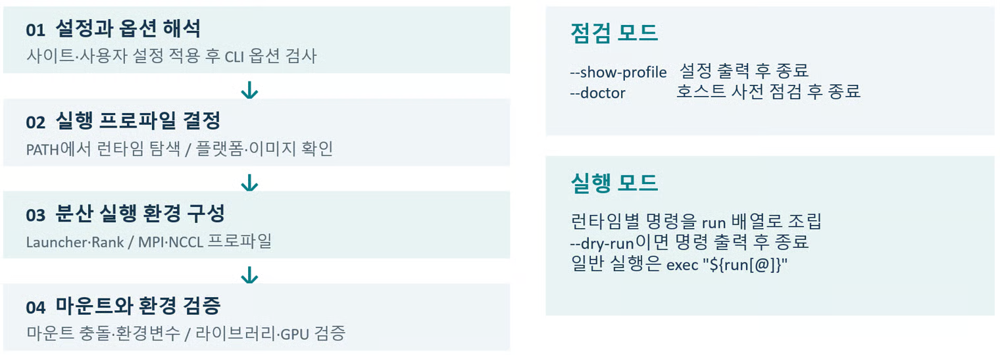

# 컨테이너 V.2 (작성중)

## 가. 개요

한강 시스템은 HPC 응용 및 AI 학습/추론 등에서 복잡한 소프트웨어 의존성을 해결하고 다양한 시스템에서 일관된 작업 환경을  유지할 수 있도록 최적화된 컨테이너 활용 환경을 제공합니다.        &#x20;

사용자는 자신의 작업 단계(빌드, 실행)에 맞춰 적절한 도구를 선택하여 사용할 수 있습니다.

**Podman**은 OCI 이미지를 빌드하고 관리하는 도구이고, 계산  작업을 실행하기 위해서는 **Enroot 또는 Apptainer** 와 같은 컨테이너 런타임을 선택적으로 사용할 수 있습니다.

또한, 병렬 연산 및 분산  학습 작업에서 고성능 네트워크(Slingshot) 기반의 MPI 및 NCCL 환경 구성을 지원하는 컨테이너 런타임 Wrapper 프로그램(**kisti-container**)을 제공하고 있습니다.   &#x20;


## 나. 빠른 따라해 보기

### 1. 제공 이미지로 바로 실행하기

Slurm 스케줄러를 통해 할당된 GPU 계산 노드에서 **Enroot 컨테이너**를 구동하여 **GPU Smoke 프로그램**을 실행하는 예제입니다. Enroot 명령어 없이 컨테이너 이미지 경로 등을 slurm 스케줄러의 파라미터로 설정하여 컨테이너를 구동하는 **Pyxis 플러그인**을 사용합니다.&#x20;

#### **1) 예제 복사하기**

```bash
## 02-gpu-smoke 예제 디렉터리 복사하기
$ mkdir -p /scratch/$USER/kisti-container/examples
$ cp -a /apps/common/kisti-container/examples/02-gpu-smoke \
  /scratch/$USER/kisti-container/examples/

## NGC Pytorch 이미지 파일(.sqsh) 복사하기
$ mkdir -p /scratch/$USER/kisti-container/images
cp -a /apps/common/kisti-container/images/pytorch-25.03-py3-aarch64.sqsh \
  /scratch/$USER/kisti-container/images/
```

#### **2) 예제 실행하기**

<pre class="language-bash"><code class="lang-bash"><strong>## 배치 작업 제출하기(GH200 GPU 계산노드 1대 할당) 
</strong><strong>$ cd /scratch/$USER/kisti-container/examples/02-gpu-smoke
</strong><strong>$ sbatch run-pyxis.sbatch
</strong>Submitted batch job 1234567

## 작업결과 확인하기
$ cat gpu-pyxis-1234567.out
GPU_SMOKE_PASS host=node0124 gpu=NVIDIA GH200 120GB shape=(2048, 2048) mean=-0.011594
GPU_SMOKE_PASS host=node0124 gpu=NVIDIA GH200 120GB shape=(2048, 2048) mean=-0.006231
GPU_SMOKE_PASS host=node0124 gpu=NVIDIA GH200 120GB shape=(2048, 2048) mean=0.022566
GPU_SMOKE_PASS host=node0124 gpu=NVIDIA GH200 120GB shape=(2048, 2048) mean=-0.048418
</code></pre>


```bash
## /scratch/$USER/kisti-container/examples/02-gpu-smoke/run-pyxis.sbatch

#!/bin/bash
#SBATCH --job-name=gpu-pyxis
#SBATCH --partition=normal
#SBATCH --comment="field=misc;appl=pytorch"
#SBATCH --nodes=1
#SBATCH --tasks-per-node=4
#SBATCH --gpus-per-node=4
#SBATCH --exclusive
#SBATCH --time=00:05:00
#SBATCH --output=%x-%j.out
#SBATCH --error=%x-%j.err

ROOT=/scratch/$USER/kisti-container
IMAGE=$ROOT/images/pytorch-25.03-py3-aarch64.sqsh
PROGRAM=$ROOT/examples/02-gpu-smoke/gpu_smoke.py

module purge
module load enroot/4.2.0

# --container-image 파라미터를 사용하여 Enroot 컨테이너 이미지를 설정함(Pyxis slurm 플러그인 사용)
srun \
  --mpi=none \
  --container-image="$IMAGE" \
  python3 "$PROGRAM"
```



### **2. 사용자 이미지 빌드 후 실행하기**

아래 예제는 먼저 Podman을 사용하여 Pytorch NGC 이미지를 베이스로 **DeepSpeed**가 포함된 사용자 이미지를 빌드하고 **Enroot 이미지 파일**로 변환합니다. **kisti-container**(컨테이너 런타임Wrapper, Slingshot 고속 네트워크 기반 NCCL 환경 구성)를 사용하여 DeepSpeed 기반 멀티 노드 분산 훈련 프로그램을 GPU 계산노드에서 실행합니다.&#x20;

#### **1) 예제 복사하기**

```bash
## 07-pytorch-deepspeed 예제 디렉터리 복사하기
$ mkdir -p /scratch/$USER/kisti-container/examples
$ cp -a /apps/common/kisti-container/examples/07-pytorch-deepspeed \
  /scratch/$USER/kisti-container/examples/
```

#### **2) 사용자 이미지 빌드하기**

```bash
## Podman 사용 설정
$ cd ~                # 사용자홈 디렉터리(/home01/[ID])로 이동             
$ touch .usepodman    
$ ls -la .usepodman
-rw-r--r-- 1 test test 0  3월  3 11:19 .usepodman
$ exit                # 로그아웃 후 다시 로그인

## 현재 디렉터리(.)의 Dockerille.pytorch_deepspeed로 'pytorch:deepspeed-aarch64' 이미지 빌드
# 로그인 노드는 사용자 별 프로세스 수 및 메모리 용량에 제한이 있기 때문에, Slurm 대화형 작업으로 할당 받은 
# 계산 노드에서 이미지 빌드를 권장함
$ salloc --partition=normal --comment="field=misc;appl=pytorch" --nodes=1 --gpus-per-node=4 \
--exclusive --time=10:00:00 

# 사용자 쉘 확인 및 계산노드 podman 초기화 스크립트 실행
$ echo $SHELL 
/bin/bash 
# bash/zsh/ksh 쉘 사용자는 podman-init.sh 스크립트 실행
$ source /apps/common/podman/podman-init.sh  
# csh/tcsh 쉘 사용자는 podman-init.csh 스크립트 실행
$ source /apps/common/podman/podman-init.csh 

# 이미지 빌드 
$ podman build -t pytorch:deepspeed-aarch64 -f Dockerille.pytorch_deepspeed .
STEP 1/2: FROM nvcr.io/nvidia/pytorch:25.03-py3
Trying to pull nvcr.io/nvidia/pytorch:25.03-py3...
--[중략]--
STEP 2/2: RUN pip install --no-cache-dir deepspeed==0.18.9
--[중략]--
Successfully tagged localhost/pytorch:deepspeed-aarch64

$ podman images
REPOSITORY                                 TAG                     IMAGE ID      CREATED        SIZE
localhost/pytorch:deepspeed-aarch64        deepspeed-aarch64       5e7a4783117b  21 minutes ago 22.1 GB

# Enroot 이미지 파일(.sqsh) 생성(read-only, 계산 노드에서 작업 실행에 적합)
$ cd /scratch/$USER/kisti-container/examples/07-pytorch-deepspeed
$ module load enroot/4.2.0
$ enroot import -o pytorch-deepspeed-aarch64.sqsh podman://localhost/pytorch:deepspeed-aarch64
[INFO] Fetching image
--[중략]--
[INFO] Extracting image content...
[INFO] Creating squashfs filesystem...
--[중략]--

$ ls -lh pytorch-deepspeed-aarch64.sqsh
-rw-r--r-- 1 a1234 a1234 11G Nov  6 13:42 pytorch-deepspeed-aarch64.sqsh
```


```bash
## /scratch/$USER/kisti-container/examples/07-pytorch-deepspeed/Dockerfile.pytorch_deepspeed

FROM nvcr.io/nvidia/pytorch:25.03-py3
RUN pip install --no-cache-dir deepspeed==0.18.9
```



#### **3) 예제 실행하기**

ZeRO 최적화로 옵티마이저 상태와 그래디언트를 GPU들에 나눠 저장하는 데이터 병렬 학습 예제입니다. GH200 2노드에서 노드당 GPU 4장, 총 8개 rank로 ZeRO-2 학습이 동작합니다.


**DeepSpeed**: Microsoft가 개발한 대규모 모델 학습 최적화 라이브러리입니다. 현재 예제의 ZeRO-2(Zero Redundancy Optimizer stage 2)는 각 GPU가 모델 전체를 가지되, 옵티마이저 상태와 그래디언트는 GPU 수만큼 나눠 저장해 GPU당 메모리 사용량을 줄이는 방식입니다.


<pre class="language-bash"><code class="lang-bash"><strong>## 배치 작업 제출하기(GH200 GPU 계산노드 2대 할당) 
</strong><strong>$ cd /scratch/$USER/kisti-container/examples/07-pytorch-deepspeed
</strong><strong>$ sbatch run-kc-enroot.sbatch
</strong>Submitted batch job 1234567

## 작업결과 확인하기
$ cat kc-ds-pyxis-1234567.out
============================================================
  DeepSpeed 분산 학습
  World size : 8
  Nodes      : 2
  GPUs/node  : 4
  Device     : NVIDIA GH200 120GB
  NCCL ver   : (2, 25, 1)
============================================================
<strong>--[중략]--
</strong>
  epoch 0 step    0  loss=10.5000
  epoch 0 step   20  loss=10.5000
  epoch 0 step   40  loss=10.4375
  epoch 0 step   60  loss=10.4375
  epoch 0 step   80  loss=10.4375
  epoch 0 step  100  loss=10.4375
  epoch 0 step  120  loss=10.4375
  epoch 0 step  140  loss=10.4375
  epoch 0 done  avg_loss=10.4383  time=6.1s  steps=157
  epoch 1 step    0  loss=10.3750
  epoch 1 step   20  loss=10.3750
  epoch 1 step   40  loss=10.3750
  epoch 1 step   60  loss=10.3750
  epoch 1 step   80  loss=10.3750
  epoch 1 step  100  loss=10.3750
  epoch 1 step  120  loss=10.3750
  epoch 1 step  140  loss=10.3750
  epoch 1 done  avg_loss=10.3857  time=6.3s  steps=157
학습 완료
</code></pre>


```bash
## /scratch/$USER/kisti-container/examples/07-pytorch-deepspeed/run-kc-enroot.sbatch

#!/bin/bash
#SBATCH --job-name=kc-ds-enroot
#SBATCH --partition=normal
#SBATCH --comment="field=misc;appl=deepspeed"
#SBATCH --nodes=2
#SBATCH --ntasks-per-node=1
#SBATCH --gpus-per-node=4
#SBATCH --cpus-per-task=72
#SBATCH --exclusive
#SBATCH --time=00:30:00
#SBATCH --output=%x-%j.out
#SBATCH --error=%x-%j.err

ROOT="/scratch/$USER/kisti-container"
KC="/apps/common/kisti-container/bin/kisti-container"
IMAGE=$ROOT/images/pytorch-25.03-py3-aarch64.sqsh
TRAIN_SCRIPT=$ROOT/examples/07-pytorch-deepspeed/train_deepspeed.py

module purge
module load aws-ofi-nccl/1.20.0
module load libfabric/2.3.1
module load enroot/4.2.0

USER=`id -un`
export CACHE_ROOT=/scratch/$USER/.cache/job-$SLURM_JOB_ID
mkdir -p $CACHE_ROOT

export TRITON_CACHE_DIR=$CACHE_ROOT/triton
export TORCH_EXTENSIONS_DIR=$CACHE_ROOT/torch_extensions
export XDG_CACHE_HOME=$CACHE_ROOT/xdg

srun \
  "${KC}" \
    --runtime enroot --workload pytorch-dist \
    --launcher torchrun --local-processes 4 --nccl ofi \
    --diagnose \
    "$IMAGE" "$TRAIN_SCRIPT" --deepspeed --deepspeed_config ${SLURM_SUBMIT_DIR}/ds_config.json --epochs 2
```



## 다. 컨테이너 도구 선택 가이드

작업 목적에 따라 아래와 같이 컨테이너 도구를 선택할 수 있습니다.

<table><thead><tr><th width="253.434814453125" align="center">필요한 작업</th><th align="center">선택 도구</th><th align="center">참고</th></tr></thead><tbody><tr><td align="center">새 이미지를 만들거나<br>패키지 추가</td><td align="center"><strong>Podman(권장)</strong><br>Apptainer</td><td align="center"><a href="container-1.md#podman"><strong>이미지 빌드</strong></a></td></tr><tr><td align="center">계산 노드에서 <br>컨테이너 기반 <br>작업 실행</td><td align="center"><strong>Enroot(권장)</strong><br>Apptainer</td><td align="center"><a href="container-1.md#id-5"><strong>이미지 실행</strong></a></td></tr><tr><td align="center">일반 이미지로<br>MPI 작업 및 분산 학습 실행</td><td align="center"><strong>kisti-container</strong></td><td align="center"><a href="container-1.md#id-3.-kisti-container"><strong>kisti-container</strong></a></td></tr></tbody></table>

Podman은 Dockerfile 기반으로 이미지를 만들고 레지스트리에 올려 관리할 수 있어 빌드 단계에 권장합니다. Apptainer는 definition 파일로 .sif 이미지를 직접 빌드할 수 있습니다. 이미지 공유가 필요하면 [**myhub**](container-1.md#id-3-1)에 저장할 수 있습니다. Podman으로 빌드한 이미지는 계산 노드에서 실행할 런타임에 맞춰 .sqsh(Enroot) 또는 .sif (Apptainer)로 변환합니다.

Enroot과 Apptainer는 실행 측면에서 같은 일을 하며 이미지 형식만 다릅니다(.sqsh/.sif). 한강에서는 Slurm 연동과 GPU 최적화를 위해 Enroot을 권장하며, 기존 누리온·뉴론에서 사용하던 .sif 이미지를 활용하실 경우에는 Apptainer를 사용하면 됩니다.

Slingshot 고속 네트워크를 지원하는 Pytorch/NeMo 이미지를 다음 경로에 제공합니다. **/apps/common/kisti-container/images/slingshot**&#x20;

다중 노드 GPU 학습에는 이 이미지 또는 이를 기반으로 만든 사용자 이미지를 권장합니다.

기존 NGC 이미지나 사용자 이미지에서 Slingshot 기반 MPI·NCCL 통신이 필요한 경우에는 **kisti-container**를 이용해 호스트 통신 환경과 연계할 수 있습니다.


* **Podman** : 일반 사용자 권한 기반의 이미지 빌드 및 관리 도구입니다. Docker를 대체하여 이미지를 생성할 때 사용합니다.
* **Enroot** : NVIDIA에서 개발한 HPC 전용 런타임으로 .sqsh 이미지를 실행합니다. Enroot을 Slurm에서 바로 실행할 수 있게 해주는 스케줄러 플러그인으로 Pyxis를 제공합니다.&#x20;
* **Apptainer** : HPC 환경에 최적화된 컨테이너 도구로 .sif 이미지를 실행합니다. Singularity에서 분리되어 발전한 오픈소스 컨테이너 런타임으로, 대부분의 이미지 형식과 사용 방식이 서로호환됩니다.
* **kisti-container** : Enroot 또는 Apptainer로 실행할 때 MPI나 분산 학습 작업에 필요한 호스트의 Slingshot 통신 환경을 연계하도록 돕는 Wrapper 입니다.



## 라. 이미지 빌드 (Podman)

작업을 실행 할 계산노드의 아키텍처에 따라 CPU 또는 GPU 로그인 노드에서 **Podman**을 사용하여 컨테이너 이미지를 빌드합니다.&#x20;


**apptainer 컨테이너 이미지**를 직접 빌드 하기 위해서는 뉴론 컨테이너 활용 가이드의  [**가. 컨테이너 이미지 빌드하기**](https://docs-ksc.gitbook.io/neuron-user-guide/appendix/appendix-3-how-to-use-singularity-container#id) 를 참조하시기 바랍니다.&#x20;


### 1. Podman 사용 설정

Podman 사용 환경 설정을 위해서는 먼저 사용자 홈 디렉터리에 **.usepodman** 이라는 파일을 생성해야 합니다. 한 번만 생성하면 되고 로그아웃 후 다시 로그인 하면 바로 적용 됩니다.

```bash
$ cd ~                # 사용자홈 디렉터리(/home01/[ID])로 이동             
$ touch .usepodman    
$ ls -la .usepodman
-rw-r--r-- 1 test test 0  3월  3 11:19 .usepodman
$ exit                # 로그아웃 후 다시 로그인
```

### 2. 이미지 빌드하기

사용자 소스 코드나 특정 라이브러리를 포함한 커스텀 이미지를 생성합니다.

```bash
## 현재 디렉터리(.)의 Dockerfile.pytorch로 'pytorch:deepspeed-aarch64' 이미지 빌드
$ podman build -t pytorch:deepspeed-aarch64 -f Dockerfile.pytorch .
$ podman images
REPOSITORY                       TAG                IMAGE ID      CREATED         SIZE
localhost/pytorch                deepspeed-aarch64  5e7a4783117b  21 minutes ago  22.1 GB
$ podman image inspect localhost/pytorch:deepspeed-aarch64 --format 'image={{.RepoTags}} arch={{.Architecture}} os={{.Os}}'
image=[localhost/pytorch:deepspeed-aarch64] arch=arm64 os=linux

## NGC 이미지 가져오기
$ podman pull nvcr.io/nvidia/pytorch:25.03-py3
Trying to pull nvcr.io/nvidia/pytorch:25.03-py3...
Getting image source signatures
Copying blob 69fbe38eb239 done   |
Copying blob 5b17151e9710 done   |
Copying blob 58f537c310dd done   |
--[중략]--
Copying config b9d9faba96 done   |
Writing manifest to image destination
b9d9faba9659ded5e9c72b694879edb79ef4a6e8786d367a2c22f83837536253
$ podman images
REPOSITORY                                 TAG                     IMAGE ID      CREATED        SIZE
localhost/pytorch:deepspeed-aarch64        deepspeed-aarch64       5e7a4783117b  21 minutes ago 22.1 GB
nvcr.io/nvidia/pytorch                     25.03-py3               b9d9faba9659  19 months ago  22 GB
```


```bash
# 베이스 이미지 지정 (slingshot 고속 네트워크를 지원하는 KISTI 제공 pytorch 이미지)
ARG BASE_IMAGE=myhub.ksc.re.kr/kisti-container/kisti-pytorch:25.03-gh200-r1-aarch64
FROM ${BASE_IMAGE}

# 메타 데이터 설정 (`docker image inspect` 등으로 이미지의 용도 확인)
LABEL org.opencontainers.image.title="kisti-container tutorial image"

# 이후 명령의 기본 작업 디렉터리 및 컨테이너 실행 기본 위치 설정
WORKDIR /workspace

# 추가 시스템 패키지 설치 (필요시)
RUN apt-get update && apt-get install -y \
    wget \
    git \
    && rm -rf /var/lib/apt/lists/*
    
# Python 라이브러리 추가 설치 (pip 활용)
RUN python3 -m pip install --no-cache-dir deepspeed==0.18.9

# 컨테이너 실행 명령을 별도로 지정하지 않았을 때 실행할 기본 명령어
CMD ["python3", "--version"]
```



**다중 노드 분산 학습**에서는 노드 간 통신 성능이 전체 성능을 좌우합니다. **Slingshot 고속 네트워크**를 **지원**하는 아래 **KISTI 제공  베이스 이미지**를 그대로 사용하거나, 이를 기반으로 사용자 이미지를 빌드 하시기 바랍니다.&#x20;

\
**(Pytorch : deepspeed 포함)** myhub.ksc.re.kr/kisti-container/kisti-pytorch:25.03-gh200-r1-aarch64

**(NeMo)** myhub.ksc.re.kr/kisti-container/kisti-nemo:25.04-gh200-r1-aarch64


**일반 이미지**를 사용하면 **NCCL**이 Slingshot 대신 **TCP**로 **동작**할 수 있습니다. 이 경우 오류 없이 학습이 완료되지만 **통신 성능**이 크게 **떨어질 수 있습**니다.  &#x20;

이미 보유한 일반 이미지를 써야 한다면, 컨테이너 런타임 Wrapper인 [**kisti-container**](container-1.md#id-3.-kisti-container)가 NCCL을 Slingshot으로 동작하도록 설정해 줍니다. 이때는 작업 스크립트에서 관련 모듈을 함께 로드해야 합니다.

bash

```bash
module load aws-ofi-nccl/1.20.0
module load libfabric/2.3.1
```

실행 후 다음으로 확인하시기 바랍니다.

bash

```bash
grep -E 'Selected provider|Using network' <작업출력파일>
```

**Selected provider is cxi**가 출력되면 정상입니다.



용량이 크고 시간이 오래 걸리는 이미지 빌드는 다수 사용자가 공유하는 로그인 노드 보다, Slurm 대화형 작업으로 할당 받은 전용 계산 노드에서 수행하는 것을 권장합니다.  &#x20;

```
# slurm 대화식 작업으로 계산 노드 할당 및 접속 
$ salloc --partition=normal --comment="field=misc;appl=pytorch" --nodes=1 --gpus-per-node=4 \
--exclusive --time=10:00:00 
salloc: Granted job allocation 1144199
salloc: Waiting for resource configuration
salloc: Nodes node0001 are ready for job
$

## 사용자 쉘 확인 및 podman 초기화 스크립트 실행
$ echo $SHELL 
/bin/bash 

# bash/zsh/ksh 쉘 사용자는 podman-init.sh 스크립트 실행
$ source /apps/common/podman/podman-init.sh  

# csh/tcsh 쉘 사용자는 podman-init.csh 스크립트 실행
$ source /apps/common/podman/podman-init.csh 

$ podman build -t pytorch:deepspeed-aarch64 -f Dockerfile.pytorch .
$ podman images
```



**참고 자료**

**1) 이미지 빌드 및 관리 명령어 요약**

```
$ podman build [옵션] -t [이미지명]:[태그] [Dockerfile경로]
-t, --tag: 이미지 이름과 버전(태그) 지정(예: my_env:v1.0)
-f, --file: 기본 파일명(Dockerfile)이 아닌 다른 이름의 파일을 사용할 때 지정
--no-cache: 캐시를 사용하지 않고 모든 단계를 새로 빌드(라이브러리 업데이트 시 유용)
-v, --volume: 빌드 과정 중 호스트 디렉토리를 마운트해야 할 때 사용

# 현재 디렉터리의 Dockerfile을 사용하여 빌드하기
$ podman build -t my_pytorch:deepspeed-aarch64 .
```

<table data-header-hidden><thead><tr><th width="111.66668701171875" align="center"></th><th width="235.60009765625"></th><th></th></tr></thead><tbody><tr><td align="center"><strong>기능</strong></td><td><strong>명령어</strong></td><td><strong>설명</strong></td></tr><tr><td align="center"><strong>목록 확인</strong></td><td><sub>$ podman images</sub></td><td>로컬에 저장된 이미지 리스트 출력</td></tr><tr><td align="center"><strong>이미지 삭제</strong></td><td><sub>$ podman rmi [이미지ID]</sub></td><td>불필요한 이미지 제거</td></tr><tr><td align="center"><strong>상세 정보</strong></td><td><sub>$ podman inspect [이미지ID]</sub></td><td>이미지 레이어, 환경변수 등 상세 정보 확인</td></tr><tr><td align="center"><strong>태그 변경</strong></td><td><sub>$ podman tag [기존이름] [새이름]</sub></td><td>이미지에 새로운 이름/태그 부여</td></tr></tbody></table>

**2) 관련 메뉴얼**

* [**Podman 사용법**](https://docs.podman.io/en/latest/Introduction.html)
* [**Dockerfile instructions**](https://docs.docker.com/build/building/best-practices#dockerfile-instructions)



### 3. 이미지 업로드

Podman으로 빌드한 이미지를 **외부 저장소인 Docker Hub** 또는 **KISTI 내부 저장소인 myhub**에 업로드하여 관리 및 공유 할 수 있습니다. 특히, 로그인  또는 계산 노드의 로컬 파일시스템에 저장된 이미지는 영구 보관되지  않기  때문에, <mark style="color:$primary;">**외부 또는 내부 저장소**</mark><mark style="color:$primary;">에</mark> <mark style="color:$primary;"></mark><mark style="color:$primary;">**이미지**</mark><mark style="color:$primary;">를</mark> <mark style="color:$primary;"></mark><mark style="color:$primary;">**업로드**</mark><mark style="color:$primary;">하는 것을</mark> <mark style="color:$primary;"></mark><mark style="color:$primary;">**권장**</mark><mark style="color:$primary;">합니다.</mark>  &#x20;

#### 1)   myhub 또는 Docker Hub 로그인

먼저 Podman을 통해 Docker Hub 또는 myhub 계정으로 인증합니다.



myhub 를 사용하기 위해서는  [**https://myhub.ksc.re.kr**](https://myhub.ksc.re.kr/)에 슈퍼컴퓨터 계정으로 로그인하여 **사용자 프로젝트**를 생성하고  **CLI 시크릿**을  복사해 와야 합니다. 자세한 사용 방법은 [**myhub 사용법**](https://docs-ksc.gitbook.io/neuron-user-guide/appendix/appendix-12-how-to-use-containers#myhub)을 참조하시기 바랍니다.&#x20;


```
$ podman login myhub.ksc.re.kr
# Username(슈퍼컴퓨터 계정 ID)와 Password(CLI secert)을 입력합니다.
```


1\) [**myhub**](https://myhub.ksc.re.kr/)에 로그인하여 **새 프로젝트**를 생성하고 액세스 레벨(공개/비공개)을 설정합니다.&#x20;

<div data-with-frame="true"><figure><figcaption></figcaption></figure></div>

2\) myhub 대시 보드 상단 오른편의 사용자 ID를 클릭하여 사용자 프로필 메뉴를 선택하고, **CLI 시크릿**을 **복사**합니다.

<div data-with-frame="true"><figure><figcaption></figcaption></figure></div>



```
$ podman login docker.io
# Username과 Password(또는 Access Token)를 입력합니다.
```



#### 2) 이미지 태그(Tag) 설정

업로드를 위해서는 이미지 이름을 **\[레지스트리주소]/\[Username 또는 프로젝트명]/\[이미지명]:\[버전태그]** 형식으로 지정해야 합니다.



**\[프로젝트명]**&#xC740; myhub에 로그인하여 생성한 **사용자 프로젝트**를 지정해야 합니다.&#x20;

```
# 로컬 이미지(pytorch:deepspeed-aarch64)를 myhub 형식으로 태그
$ podman tag localhost/pytorch:deepspeed-aarch64 myhub.ksc.re.kr/[프로젝트명]/pytorch:deepspeed-aarch64
```



<pre><code><strong># 로컬 이미지(pytorch:deepspeed-aarch64)를 Docker Hub 형식으로 태그
</strong>$ podman tag localhost/pytorch:deepspeed-aarch64 docker.io/[Username]/pytorch:deepspeed-aarch64
</code></pre>



#### 3) 이미지 업로드(Push)

태그가 완료된 이미지를 Docker Hub 또는 myhub로 전송합니다.



```
$ podman push myhub.ksc.re.kr/[프로젝트명]/pytorch:deepspeed-aarch64
```



```
$ podman push docker.io/[Username]/pytorch:deepspeed-aarch64
```



#### 4) 이미지 변환&#x20;

**Podman** 또는 **Docker Hub**, **myhub** 등에 저장된 사용자 이미지는 컨테이너 실행 도구에 맞는 변환 과정을 거쳐야  합니다.

**a. Enroot**&#x20;

Podman으로 빌드한 이미지를 Enroot 실행용 SquashFS 포맷으로 변환하여 .sqsh 파일로  저장합니다.&#x20;

<pre class="language-bash"><code class="lang-bash"># sqsh 이미지 파일 생성(read-only, 계산 노드에서 작업 실행에 적합)
$ module load enroot/4.2.0
<strong>
</strong><strong># Podman 이미지
</strong>$ enroot import -o pytorch-deepspeed-aarch64.sqsh podman://localhost/pytorch:deepspeed-aarch64

# Docker Hub 이미지
$ enroot import -o pytorch-deepspeed-aarch64.sqsh docker://[Username]/pytorch:deepspeed-aarch64

# myhub 이미지
$ enroot import -o pytorch-deepspeed-aarch64.sqsh docker://myhub.ksc.re.kr/[프로젝트명]/pytorch:deepspeed-aarch64

# sqsh 이미지 파일로부터 컨테이너 rootfs(unpacked 디렉터리) 생성 
# write 가능하며 이미지 빌드 및 시험에 적합 
$ enroot create -n pytorch-deepspeed-aarch64 pytorch-deepspeed-aarch64.sqsh
</code></pre>


**Enroot 이미지 관련 명령어**&#x20;

<table data-header-hidden><thead><tr><th width="86.020263671875" align="center"></th><th width="140.97393798828125" align="center"></th><th></th></tr></thead><tbody><tr><td align="center"><strong>단계</strong></td><td align="center"><strong>작업 내용</strong></td><td><strong>명령어 / 설정 예시</strong></td></tr><tr><td align="center"><strong>이미지 가져오기</strong></td><td align="center"><sub>Docker Hub 및 myhub 등</sub>  <br><sub>외부 레지스트리에서 직접 가져오기</sub></td><td><p><sub>$ enroot import -o my_pytorch-v1.sqsh docker://[Username]/my_pytorch:v1</sub></p><p></p><p><sub>$ enroot import -o my_pytorch-v1.sqsh docker://myhub.ksc.re.kr/[프로젝트명]/ubuntu:latest</sub></p></td></tr><tr><td align="center"><strong>컨테이너 생성</strong></td><td align="center"><sub>rootfs</sub><br><sub>(unpacked</sub> <br><sub>디렉터리)</sub> <br><sub>생성하기</sub></td><td><p><sub>$ enroot create -n my_pytorch-v1</sub><sup><sub>*</sub></sup><sub> my_pytorch-v1.sqsh</sub>     </p><p><sup><sub>*</sub></sup><sub> 컨테이너(rootfs)는 enroot info 명령어를 사용하여 <code>ENROOT_DATA_PATH</code>에서 확인할 수 있습니다.</sub> </p></td></tr><tr><td align="center"><strong>컨테이너</strong> <br><strong>리스트</strong></td><td align="center"><sub>enroot create</sub> <br><sub>명령어로 생성한</sub> <br><sub>컨테이너 목록 출력</sub></td><td><p><sub>$ enroot list</sub><sup><sub>*</sub></sup> </p><p><sup><sub>*</sub></sup><sub>컨테이너를 생성한 노드에서만 출력됨</sub></p></td></tr><tr><td align="center"><strong>컨테이너 삭제</strong></td><td align="center"><sub>enroot create</sub> <br><sub>명령어로 생성한</sub> <br><sub>컨테이너 제거</sub></td><td><p><sub>$ enroot remove my_pytorch-v1</sub><sup><sub>*</sub></sup></p><p><sup><sub>*</sub></sup><sub>컨테이너를 생성한 노드에서만 제거할 수 있음</sub></p></td></tr></tbody></table>



**b. Apptainer**

Podman으로 빌드한 이미지를 Apptainer 실행용 SIF(Singularity Image Format) 포맷으로 변환하여 .sif 파일로 저장합니다.&#x20;

```bash
## Podman 이미지를 tar로 내보낸 후 .sif 파일로 빌드
$ podman save localhost/pytorch:deepspeed-aarch64 -o pytorch-deepspeed-aarch64.tar

# Apptainer에서 용량이 큰 이미지를 변환 또는 가져올 때 로그인 노드는 사용자 별 
# 메모리 용량 제한으로 에러가 발생할 수 있음.
# slurm 대화식 작업으로 할당 받은 계산 노드에서 이미지 변환 또는 가져오기 실행을 권장함

# slurm 대화식 작업으로 계산 노드 할당 및 접속 
$ salloc --partition=normal --comment="field=misc;appl=pytorch" --nodes=1 --gpus-per-node=4 \
--exclusive --time=10:00:00 
salloc: Granted job allocation 1144199
salloc: Waiting for resource configuration
salloc: Nodes node0001 are ready for job
$ 

# tar 이미지 파일로부터 변환하기 
$ module load apptainer/1.4.5
$ apptainer build pytorch-deepspeed-aarch64.sif docker-archive://pytorch-deepspeed-aarch64.tar

## Docker Hub 또는 myhub에서 이미지 가져오기
$ module load apptainer/1.4.5
$ apptainer pull pytorch-deepspeed-aarch64.sif docker://myhub.ksc.re.kr/[프로젝트명]/pytorch:deepspeed-aarch64
```


**KISTI에서 빌드하여  배포하는 Enroot(.sqsh), Apptainer(.sif) 이미지 파일 경로**&#x20;

* _**일반 NGC 이미지  :  /apps/common/kisti-container/images**_

<pre class="language-bash"><code class="lang-bash"><strong>(Pytorch : deepspeed 포함)
</strong><strong>## GH200 GPU 계산 노드 지원
</strong>pytorch-25.03-py3-aarch64.sqsh  
pytorch-25.03-py3-aarch64.sif 

## x86_64 CPU + GPU 계산 노드 지원 
pytorch-25.03-py3-x86_64.sqsh
pytorch-25.03-py3-x86_64.sif   

(NeMo)
## GH200 GPU 계산 노드 지원 
nemo-25.04.00-aarch64.sqsh  
nemo-25.04.00-aarch64.sif  
</code></pre>


* **Slingshot 고속 네트워크 지원 이미지  : /apps/common/kisti-container/images/slingshot**

<pre class="language-bash" data-title="GH200 GPU 계산 노드 지원"><code class="lang-bash"><strong>(Pytorch : deepspeed 포함)
</strong>kisti-pytorch-25.03-gh200-r1-aarch64.sif  
kisti-pytorch-25.03-gh200-r1-aarch64.sqsh

(NeMo)
kisti-nemo-25.04-gh200-r1-aarch64.sif
kisti-nemo-25.04-gh200-r1-aarch64.sqsh
</code></pre>


#### 3) 아키텍처와 이미지 호환성

컨테이너 이미지의 CPU 아키텍처는 로그인/계산 노드와 같아야 합니다.

<table><thead><tr><th width="207.98016357421875" align="center">노드 구분
(Slurm 파티션)</th><th width="167.03265380859375" align="center">CPU 아키텍처</th><th width="127.53631591796875" align="center">GPU</th><th align="center">이미지 파일 예시</th></tr></thead><tbody><tr><td align="center">GH200 GPU 노드<br>(normal)</td><td align="center"><code>aarch64(arm64)</code><br><code>(Grace CPU)</code></td><td align="center">Hopper GPU</td><td align="center"><sub>pytorch-25.03-py3-aarch64.sif</sub><br><sub>pytorch-25.03-py3-aarch64.sqsh</sub></td></tr><tr><td align="center">CPU 노드<br>(normal_cpu, bigsmp)</td><td align="center"><code>x86_64</code><br><code>(AMD EPYC CPU)</code></td><td align="center">없음</td><td align="center"><sub>pytorch-25.03-py3-x86_64.sif</sub></td></tr></tbody></table>

**a. 현재 노드 아키텍처 확인**

```bash
$ uname -m  (GH200 GPU 노드)
aarch64

$ uname -m   (AMD EPYC CPU 노드)
x86_64
```

**b. 이미지 아키텍처 확인**

아키텍처 판별이 용이하도록  이미지 태그(Podman) 또는 파일명에 aarch64(arm64) 또는 x86\_64(amd64) 를 넣는 것을 권장합니다.

<pre class="language-bash"><code class="lang-bash"><strong>## Podman
</strong>## exec format error가 발생하면 이미지와 계산 노드의 아키텍처를 먼저 비교합니다. 
<strong>$ podman image inspect myhub.ksc.re.kr/wjnadia/pytorch:25.03-py3-aarch64 --format '{{.Architecture}}'
</strong>arm64

## Enroot
$ module load enroot/4.2.0
$ enroot create -n pytorch-25.03-py3-aarch64 pytorch-25.03-py3-aarch64.sqsh
$ enroot start pytorch-25.03-py3-aarch64 uname -m
aarch64

## Apptainer
$ module load apptainer/1.4.5
$ apptainer inspect --labels pytorch-25.03-py3-x86_64.sif | grep build-arch
org.label-schema.build-arch: amd64   
</code></pre>


## 마. 이미지 실행

생성된 이미지는 **Enroot** 또는 **Apptainer** 환경에 배포하여 실행할 수 있습니다. 아래 예시는 **slurm 대화식 작업**으로 스케줄러가 할당한 **계산 노드**에서 각  **컨테이너 런타임 별** **이미지 실행 예시** 입니다. &#x20;

### 1. Enroot

```bash
# GPU 계산 노드에서 squashFS 이미지 파일을 로드하고 실행
# GPU 가속 연동 옵션 필요 없음(자동 연동됨)

$ salloc --partition=normal --comment="field=misc;appl=pytorch" --nodes=1 --gpus-per-node=4 \
--exclusive --time=01:00:00
$ export IMAGE="/apps/common/kisti-container/images/pytorch-25.03-py3-aarch64.sqsh"
$ export PROGRAM="/apps/common/kisti-container/examples/02-gpu-smoke/gpu_smoke.py"
$ module load enroot/4.2.0
$ enroot create -n pytorch-25.03-py3-aarch64 "$IMAGE"
$ enroot start pytorch-25.03-py3-aarch64 python3 "$PROGRAM"
GPU_SMOKE_PASS host=node0001 gpu=NVIDIA GH200 120GB shape=(2048, 2048) mean=0.039116

# Pyxis는 Enroot의 slurm 플러그인으로 enroot 명령어 없이 이미지 및 마운트 경로 등을 
# 설정하여 사용자 프로그램을 실행할 수 있음  

$ module load enroot/4.2.0
$ export IMAGE="/apps/common/kisti-container/images/pytorch-25.03-py3-aarch64.sqsh"
$ salloc --partition=normal --comment="field=misc;appl=pytorch" --nodes=1 --gpus-per-node=4 \
--exclusive --time=01:00:00 --container-image="$IMAGE" 
$ export PROGRAM="/apps/common/kisti-container/examples/02-gpu-smoke/gpu_smoke.py"
$ python3 "$PROGRAM"
GPU_SMOKE_PASS host=node0001 gpu=NVIDIA GH200 120GB shape=(2048, 2048) mean=0.039116
```


**Enroot/Pyxis 참고 자료**&#x20;

* [**Enroot 사용법** ](container-1.md#id)
* [**Pyxis(Enroot Slurm 플러그인) 사용법**](https://github.com/NVIDIA/pyxis/wiki/Usage)


### 2. Apptainer

```bash
# GPU 계산노드에서 Apptainer 이미지를 로드하여 실행
# --nv: GPU 가속 연동 옵션 필수
# apptainer는 singularity와 명령어 이름만 다르고 옵션 및 이미지가 상호 호환이 됨

$ salloc --partition=normal --comment="field=misc;appl=pytorch" --nodes=1 --gpus-per-node=4 \
--exclusive --time=01:00:00
$ export IMAGE="/apps/common/kisti-container/images/pytorch-25.03-py3-aarch64.sif"
$ export PROGRAM="/apps/common/kisti-container/examples/02-gpu-smoke/gpu_smoke.py"
$ module load apptainer/1.4.5
$ apptainer exec --nv "$IMAGE" python3 "$PROGRAM"
GPU_SMOKE_PASS host=node0001 gpu=NVIDIA GH200 120GB shape=(2048, 2048) mean=0.039116
```


&#x20;**Apptainer 참고 자료**

* [Apptainer 공식 사용자 가이드](https://apptainer.org/docs/user/main/introduction.html)
* [뉴론 Singularity 컨테이너 사용자 지침서](https://docs-ksc.gitbook.io/neuron-user-guide/appendix/appendix-3-how-to-use-singularity-container)



**Podman에서 이미지 실행 방법**

```
# 모든 GPU 사용
$ podman run --rm --device nvidia.com/gpu=all \
    nvcr.io/nvidia/pytorch  nvidia-smi

# 여러 장치 중 특정 GPU(예: 0번)만 사용
$ podman run --rm --device nvidia.com/gpu=0 \
    nvcr.io/nvidia/pytorch  nvidia-smi
```


### 3. kisti-container&#x20;

kisti-container는 컨테이너 런타임을 감싸는 실행 래퍼로 **Slingshot을 지원하지 않는 이미지를 실행할 때 사용**할 수 있습니다. **MPI**나 **분산 학습 작업**을 컨테이너에서 실행할 때 필요한 설정\*을 자동으로 처리합니다. Enroot, Apptainer를 지원하며, 노드의 CPU 아키텍처와 로드된 모듈을 보고 필요한 설정을 자동으로 선택합니다.

\***Slingshot** 네트워크 라이브러리 연결, **NCCL** 통신 플러그인 지정, **분산 환경변수** 지정

<figure><figcaption><p>kisti-container 워크플로우</p></figcaption></figure>

#### **1)  기본 명령 형식**

<pre class="language-bash"><code class="lang-bash">$ export PATH=$PATH:/apps/common/kisti-container/bin
$ kisti-container --help
<strong>$ kisti-container [Wrapper 옵션] IMAGE COMMAND [ARG ...]
</strong></code></pre>

#### **2) 주요 옵션**

<table data-search="false"><thead><tr><th width="178.07244873046875">옵션</th><th>값</th><th>설명</th></tr></thead><tbody><tr><td><code>--runtime</code></td><td> <code>enroot,apptainer</code></td><td>컨테이너 런타임<br>(Default : enroot)</td></tr><tr><td><code>--workload</code></td><td><code>generic</code>, <code>pytorch-dist*</code></td><td>워크로드 구분 <br>(Default : generic)</td></tr><tr><td><code>--launcher</code></td><td><code>srun-native</code>, <code>torchrun</code></td><td>분산 프로세스 생성 방식** <br>(Default : srun-native)</td></tr><tr><td><code>--local-processes</code></td><td>양의 정수</td><td>노드별 torchrun worker 수</td></tr><tr><td><code>--mpi</code></td><td><code>none</code>, <code>cray</code>, <code>openmpi</code>, <code>auto</code></td><td>MPI 구성 <br>(Default : auto)</td></tr><tr><td><code>--nccl</code></td><td><code>none</code>, <code>native</code>, <code>ofi</code>, <code>auto</code></td><td>NCCL 전송 구성 <br>(Default : none)</td></tr><tr><td><code>--provider</code></td><td>cxi</td><td>MPI/NCCL OFI Provider <br>(Default : cxi)</td></tr><tr><td><code>-B</code>, <code>--bind</code></td><td><code>SRC:DST:MODE</code></td><td>추가 마운트</td></tr><tr><td><code>--env</code></td><td><code>NAME=VALUE</code></td><td>컨테이너에 전달할 환경 변수</td></tr><tr><td><code>--diagnose</code></td><td>값 없음</td><td>rank 0에서 결정된 설정 출력</td></tr><tr><td><code>--debug-nccl</code></td><td>값 없음</td><td>NCCL 디버그 정보 출력</td></tr><tr><td><code>--doctor</code></td><td>값 없음</td><td>GPU, CXI, OFI 라이브러리 사전 점검</td></tr><tr><td><code>--dry-run</code></td><td>값 없음</td><td>실행하지 않고 최종 명령 출력</td></tr></tbody></table>

\***pytorch-dist** : torch.distributed 기반 분산 학습 (DDP, FSDP, DeepSpeed, NeMo/Megatron 등)

\*\***srun-native**는 Slurm이 GPU마다 학습 워커 프로세스를 직접  구동하고, **torchrun**은 노드당 torchrun 에이전트 하나가 그 안에서 학습 워커 프로세스를 구동합니다.


#### **3) 컨테이너 런타임 별 실행 방법**&#x20;

&#x20;   **a. Enroot**

Enroot에서 kisti-container는  Slurm task 안에서 실행되는 Wrapper 프로그램입니다. 예제와 같이 작업 스크립트 파일을 작성하고 "sbatch \[작업  스크립트 파일명]" 명령어를 사용하여 배치작업을 제출합니다. &#x20;


```bash

#!/bin/bash
#SBATCH --job-name=kc-gpu-enroot
#SBATCH --partition=normal
#SBATCH --comment="misc;appl=pytorch"
#SBATCH --nodes=1
#SBATCH --gpus-per-node=1
#SBATCH --exclusive
#SBATCH --time=00:30:00
#SBATCH --output=%x-%j.out
#SBATCH --error=%x-%j.err

export IMAGE="/apps/common/kisti-container/images/pytorch-25.03-py3-aarch64.sqsh"
export PROGRAM="/apps/common/kisti-container/examples/02-gpu-smoke/gpu_smoke.py"

module purge
module load enroot/4.2.0
srun --mpi=none \
/apps/common/kisti-container/bin/kisti-container \
  --runtime enroot \
  "$IMAGE" python3 "$PROGRAM"
```



**b. Apptainer**

Apptainer에서 kisti-container는  Slurm task 안에서 실행되는 Wrapper 프로그램입니다.  따라서 배치 작업 스크립트에서 srun을 사용하여 실행합니다. 아래  예제와 같이 작업 스크립트 파일을 작성하고 "sbatch \[작업  스크립트 파일]" 명령어를 사용하여 배치작업을 제출합니다. &#x20;


```bash

#!/bin/bash
#SBATCH --job-name=kc-gpu-sing
#SBATCH --partition=normal
#SBATCH --comment="misc;appl=pytorch"
#SBATCH --nodes=1
#SBATCH --gpus-per-node=1
#SBATCH --exclusive
#SBATCH --time=00:30:00
#SBATCH --output=%x-%j.out
#SBATCH --error=%x-%j.err

export IMAGE="/apps/common/kisti-container/images/pytorch-25.03-py3-aarch64.sif"
export PROGRAM="/apps/common/kisti-container/examples/02-gpu-smoke/gpu_smoke.py"

module purge
module load singularity/4.5.0
srun --mpi=none \
  /apps/common/kisti-container/bin/kisti-container \
    --runtime singularity \
    "$IMAGE" python3 "$PROGRAM"
```



#### **4) 다중 노드 통신 환경 점검**

2노드 이상 GPU 계산 노드에서 작업은 다음과  같이 배치 스크립트를 실행하여 **CXI** 및 **NCCL 플러그인** 등의   통신 환경을 사전 점검할 수 있습니다. **aws-ofi-nccl, libfabric, enroot** 모듈을 로드하고  kisti-container에서 **--nccl ofi --doctor**  옵션을 설정해야 합니다.&#x20;

**a. 배치 스크립트 예제**


```bash

#!/bin/bash
#SBATCH --job-name=kc-node-doctor
#SBATCH --partition=normal
#SBATCH --comment="misc;appl=pytorch"
#SBATCH --nodes=2
#SBATCH --ntasks-per-node=4
#SBATCH --gpus-per-node=4
#SBATCH --cpus-per-task=72
#SBATCH --exclusive
#SBATCH --time=00:30:00
#SBATCH --output=%x-%j.out
#SBATCH --error=%x-%j.err

IMAGE=/apps/common/kisti-container/images/pytorch-25.03-py3-aarch64.sqsh

module purge
module load aws-ofi-nccl/1.20.0
module load libfabric/2.3.1
module load enroot/4.2.0

## 계산노드의 CXI 및 NCC 플러그인 등의 통신 환경 점검을 위해 --nccl ofi --doctor 옵션 설정
srun --nodes=2 --ntasks=2 --ntasks-per-node=1 \
  --gpus-per-node=4 --gpu-bind=none --gres-flags=allow-task-sharing \
  --mpi=none \
  /apps/common/kisti-container/bin/kisti-container \
    --runtime enroot --nccl ofi --doctor  \
    "$IMAGE"
```


**b. 배치 작업 제출 및 결과 확인**

```bash
$ sbatch kc-node-doctor.sbatch
```

정상 상태에서는 작업 출력 파일에 **CXI, NCCL\_PLUGIN, LIBFABRIC, LIBCXI**가 **PASS**로 표시되고 라이브러리 경로도 출력 됩니다.

```bash
$ cat kc-node-doctor-*.out
[kisti-container] doctor platform=aarch64-gpu workload=pytorch-dist launcher=srun-native
[kisti-container] doctor host_arch=aarch64 image_arch=unknown expected_arch=aarch64
[kisti-container] doctor CXI=PASS
[kisti-container] doctor NCCL_PLUGIN=PASS /apps/library/aws-ofi-nccl/1.20.0/aarch64/lib/libnccl-net-ofi.so
[kisti-container] doctor LIBFABRIC=PASS /opt/cray/libfabric/2.3.1/lib64/libfabric.so.1
[kisti-container] doctor LIBCXI=PASS /usr/lib64/libcxi.so.1
[kisti-container] doctor /dev/shm=tmpfs           239G   64K  239G   1% /dev/shm
[kisti-container] doctor memlock=unlimited
[kisti-container] DOCTOR_PASS
```

#### **5) 문제 해결**

**a. 작업 상태와 종료 코드 확인**

```bash
sacct -j JOBID --format=JobID,JobName%30,State,ExitCode,Elapsed,NodeList%30
```


**b. 핵심 로그 검색**

```bash
grep -hiE 'PASS|FAIL|NCCL|Libfabric|CXI|Traceback|ERROR' \
  JOBNAME-JOBID.out JOBNAME-JOBID.err
```


**c. 주요 오류 별 조치 방법**

<table data-search="false"><thead><tr><th align="center">오류 또는 현상</th><th align="center">확인 항목</th><th align="center">조치</th></tr></thead><tbody><tr><td align="center">enroot 이미지 마운트 실패<br><sub>[ERROR] Failed to mount: *.sqsh</sub></td><td align="center">enroot 모듈  로드  여부<br><sub>module list</sub> </td><td align="center"><sub>module load enroot/4.2.0</sub> </td></tr><tr><td align="center">NCCL 통신 플러그인 에러<br><sub>network AWS Libfabric not found</sub></td><td align="center">OFI 모듈 로드 여부<br><sub>module list</sub></td><td align="center"><p><sub>module load aws-ofi-nccl/1.20.0</sub></p><p><sub>module load libfabric/2.3.1</sub></p></td></tr></tbody></table>


## 바. 스케줄러(SLURM)를 통한 작업 실행 예제

**컨테이너  런타임** 또는 **kisti-container**를 함께 사용하는 Slurm 작업  스크립트를 작성 및 제출하여 계산노드에서 사용자 작업을 실행할 수 있습니다. 아래와 같이 관심 있는 작업 유형의 **예제 디렉터리**와 예제 실행에 필요한 **이미지 파일**을 사용자 작업 공간으로 복사하여 실행해 볼 수 있습니다.

<pre class="language-bash" data-title="예제 디렉터리"><code class="lang-bash"><strong>$ ls -l /apps/common/kisti-container/examples
</strong>01-cpu-smoke  
02-gpu-smoke  
03-mpi-omb  
04-pytorch-ddp  
05-pytorch-fsdp2  
06-nemo-megatron  
07-pytorch-deepspeed  
</code></pre>


```bash
- 기본 이미지 : /apps/common/kisti-container/images  
- Slingshot 고속 네트워크 지원 이미지 : /apps/common/kisti-container/images/slingshot 
```



```bash
# 예제 디렉터리
$ mkdir -p /scratch/$USER/kisti-container/examples

$ cp -a /apps/common/kisti-container/examples/04-pytorch-ddp \
  /scratch/$USER/kisti-container/examples/

# 이미지 파일
$ mkdir -p /scratch/$USER/kisti-container/images
cp -a /apps/common/kisti-container/images/pytorch-25.03-py3-aarch64.sif \
  /scratch/$USER/kisti-container/images/
cp -a /apps/common/kisti-container/images/pytorch-25.03-py3-aarch64.sqsh \
  /scratch/$USER/kisti-container/images/
```



AI 관련 참고 자료는 **한강 지침서 > 소프트웨어**에서 아래 항목들을 참조하시기 바랍니다.&#x20;

* [**AI 프레임워크**](https://docs-ksc.gitbook.io/hangang-user-guide/software/ai)&#x20;
* [**Pytorch**](https://docs-ksc.gitbook.io/hangang-user-guide/software/pytorch)
* [**NCCL 활용 및 Slingshot 연동**](https://docs-ksc.gitbook.io/hangang-user-guide/software/nccl-slingshot)&#x20;


### **1.  kisti-container MPI 작업**

일반적으로 컨테이너의 MPI에서 slingshot을 사용하여 통신을 하기 위해서는 slingshot 통신 라이브러리와 이를 지원하는 MPI를 포함한 컨테이너 이미지를 직접 빌드해야 합니다.

kisti-container는 --mpi 옵션으로 지정한 MPI 유형에 맞춰 **호스트**의 **MPI 및 통신  라이브러리를  컨테이너**에서 **사용**할 수 있도록 **연결**하고 관련 **환경 변수**를 **설정**합니다.&#x20;

kisti-container를 사용하는 MPI 작업은 --workload=generic 옵션(기본값으로 생략 가능)을 사용하며, MPI 유형에 따른 관련 옵션은 아래와 같습니다.&#x20;

|    구분   |       srun 옵션      | kisti-container 옵션 |
| :-----: | :----------------: | :----------------: |
| CrayMPI | --mpi=cray\_shasta |     --mpi cray     |
| OpenMPI |     --mpi=pmix     |    --mpi openmpi   |

아래 예제는 2 노드 8 프로세스 환경에서 Apptainer 컨테이너를 구동하여노드 간 **CPU MPI 통신 성능**을 **측정**합니다. **OMB(OSU Micro-Benchmarks)**&#xC758; 두 가지 측정을 수행하는데, osu\_multi\_lat 는 여러 프로세스 쌍이 동시에 메시지를 주고 받을 때의 지연시간을, osu\_mbw\_mr은 같은 조건에서의 대역폭과 메시지 처리율을 측정합니다.


```bash
## /apps/common/kisti-container/examples/03-mpi-omb/run-gh200-apptainer.sbatch

#!/bin/bash
#SBATCH --job-name=gh200-omb-apptainer
#SBATCH --comment="field=misc;appl=misc"
#SBATCH --partition=normal
#SBATCH --nodes=2
#SBATCH --ntasks-per-node=4
#SBATCH --gpus-per-node=4
#SBATCH --cpus-per-task=1
#SBATCH --exclusive
#SBATCH --time=00:10:00
#SBATCH --output=%x-%j.out
#SBATCH --error=%x-%j.err

KC="/apps/common/kisti-container/bin/kisti-container"
IMAGE="/scratch/$USER/kisti-container/images/omb-7.5.2-aarch64.sif"

OMB="/opt/omb/cray-mpich/7.5.2/pt2pt"

module purge
module load cray-mpich/9.0.1
module load libfabric/2.3.1
module load apptainer/1.4.5

echo "===== [CrayMPI] GH200 OMB APPTAINER LATENCY ====="
srun \
  --mpi=cray_shasta --nodes=2 --ntasks=8 --ntasks-per-node=4 --cpus-per-task=1 \
  --distribution=block:block --cpu-bind=cores \
  "$KC" \
    --runtime apptainer --workload generic --mpi cray \
    --provider cxi --diagnose \
    "$IMAGE" "$OMB/osu_multi_lat"

echo "===== [CrayMPI] GH200 OMB APPTAINER BANDWIDTH ====="
srun \
  --mpi=cray_shasta --nodes=2 --ntasks=8 --ntasks-per-node=4 --cpus-per-task=1 \
  --distribution=block:block --cpu-bind=cores \
  "$KC" \
    --runtime apptainer --workload generic --mpi cray \
    --provider cxi --diagnose \
    "$IMAGE" "$OMB/osu_mbw_mr"

OMB="/opt/omb/openmpi/7.5.2/pt2pt"

module purge
module load openmpi/5.0.10
module load libfabric/2.3.1
module load apptainer/4.5.0

echo "===== [OpenMPI] GH200 OMB APPTAINER LATENCY ====="
srun \
  --mpi=pmix --nodes=2 --ntasks=8 --ntasks-per-node=4 --cpus-per-task=1 \
  --distribution=block:block --cpu-bind=cores \
  "$KC" \
    --runtime apptainer --workload generic --mpi openmpi \
    --provider cxi --diagnose \
    "$IMAGE" "$OMB/osu_multi_lat"

echo "===== [OpenMPI] GH200 OMB APPTAINER BANDWIDTH ====="
srun \
  --mpi=pmix --nodes=2 --ntasks=8 --ntasks-per-node=4 --cpus-per-task=1 \
  --distribution=block:block --cpu-bind=cores \
  "$KC" \
    --runtime apptainer --workload generic --mpi openmpi \
    --provider cxi --diagnose \
    "$IMAGE" "$OMB/osu_mbw_mr"
```


작업제출:

<pre class="language-bash"><code class="lang-bash"><strong>$ sbatch run-gh200-apptainer.sbatch
</strong></code></pre>

결과파일:

<pre class="language-bash"><code class="lang-bash"><strong>$ cat gh200-omb-apptainer-*.out
</strong>===== [CrayMPI] GH200 OMB APPTAINER BANDWIDTH =====
# OSU MPI Multiple Bandwidth / Message Rate Test v7.5.2
# [ pairs: 4 ] [ window size: 64 ]
# Datatype: MPI_CHAR.
# Size                  MB/s        Messages/s
1                       8.36        8361985.11
2                      16.57        8284756.13
4                      33.39        8348405.71
8                      66.63        8328298.94
--[중략]--
524288             190569.95         363483.34
1048576            192158.82         183256.93
2097152            193140.30          92096.47
4194304            193711.29          46184.37
===== [OpenMPI] GH200 OMB APPTAINER BANDWIDTH =====
# OSU MPI Multiple Bandwidth / Message Rate Test v7.5.2
# [ pairs: 4 ] [ window size: 64 ]
# Datatype: MPI_CHAR.
# Size                  MB/s        Messages/s
1                       5.71        5711864.23
2                      11.63        5816973.47
4                      23.18        5793892.90
--[중략]--
524288             190285.40         362940.59
1048576            191985.38         183091.53
2097152            193126.48          92089.88
4194304            193713.41          46184.88
</code></pre>


### **2. PyTorch DDP**

이 예제는 2노드 8GPU 환경에서 DDP 통신이 정상 동작하는지 확인하는 간단한 테스트 입니다. 노드당 4개의 Slurm rank(GPU당 1개)를 생성하고, 각 rank가 자신의 rank 번호를 all-reduce로 합산해 결과가 예상값과 일치하는지 검증합니다. 모든 rank가 서로 다른 두 노드에 걸쳐 배치되었는지도 함께 확인하므로, 노드 간 통신까지 실제로 이루어졌음을 보장합니다.

정상 종료되면 rank별 호스트명과 GPU 정보, NCCL 설정값이 JSON으로 출력됩니다.


**DDP :  Distributed Data Parallel**

&#x20;**Pytorch**의 **기본 분산 학습 방식**으로 각 GPU에 모델 전체를 복제하고, 서로 다른 데이터로 계산한 그래디언트를 동기화해 동일한 모델 상태를 유지합니다. 모델이 GPU 메모리에 올라가는 규모에 적합합니다. 모델 자체가 한 GPU에 들어가지 않으면 FSDP나 텐서 병렬(Megatron) 방식을 사용합니다.


#### **1) Pyxis 작업 스크립트 예제**

컨테이너 런타임을 직접 사용하는 방식으로, 분산 학습에 필요한 설정을 스크립트에서 직접 지정합니다. --ntasks-per-node-4 로 Slurm이 GPU 마다 학습 워커를 하나씩 구동하고, 워커들이 서로를 찾을 접속 지점(MASTER\_ADDR) 과 포트(MASTSER\_PORT)를 지정합니다. 포트는 충돌 가능성을 낮추기 위해 작업 ID 기반  값을 사용합니다.&#x20;


```bash

#!/bin/bash
#SBATCH --job-name=ddp-pyxis
#SBATCH --partition=normal
#SBATCH --comment="field=sciai;appl=pytorch-ddp"
#SBATCH --nodes=2
#SBATCH --ntasks-per-node=4
#SBATCH --gpus-per-node=4
#SBATCH --cpus-per-task=4
#SBATCH --exclusive
#SBATCH --time=00:15:00
#SBATCH --output=%x-%j.out
#SBATCH --error=%x-%j.err

ROOT=/scratch/$USER/kisti-container
IMAGE=$ROOT/images/slingshot/kisti-pytorch-25.03-gh200-r1-aarch64.sqsh 
PROGRAM=$ROOT/examples/04-pytorch-ddp/ddp_smoke.py

CHECKPOINT_DIR=$SLURM_SUBMIT_DIR/checkpoints/ddp-pyxis-$SLURM_JOB_ID
mkdir -p "$CHECKPOINT_DIR"

module purge
module load enroot/4.2.0

# DDP rendezvous
export MASTER_ADDR=$(scontrol show hostnames "$SLURM_JOB_NODELIST" | head -n1)
export MASTER_PORT=$((20000 + SLURM_JOB_ID % 20000))
export WORLD_SIZE=$SLURM_NTASKS

echo "MASTER=$MASTER_ADDR:$MASTER_PORT WORLD_SIZE=$WORLD_SIZE"

#export NCCL_DEBUG=INFO
#export NCCL_DEBUG_SUBSYS=INIT,NET

srun --mpi=none --kill-on-bad-exit=1 --distribution=block:block \
  --gpu-bind=none --gres-flags=allow-task-sharing \
  --container-image="$IMAGE" \
  python3 "$PROGRAM"
```


#### **2) kisti-container Pyxis 작업 스크립트 예제**

같은 작업을 kisti-container로 실행합니다. 위에서 직접 지정했던 설정을 kisti-container가 대신 처리하므로 MASTER\_ADDR과 MASTER\_PORT 계산이 필요 없습니다.

\--nccl ofi는 NCCL이 Slingshot을 쓰도록 통신 플러그인과 라이브러리를 연결합니다. 이 예제가 Slingshot 스택이 없는 일반 이미지를 쓰면서도 동작하는 이유이며, 호스트의 aws-ofi-nccl과 libfabric  모듈을 로드하는 것도 이것 때문입니다. --diagnose를  붙이면 적용된 설정이 실행 전에 출력 됩니다. 통신 설정을 확인하려면 --debug-nccl 옵션을 붙이고 출력에서 Selected provider is cxi 가 나오는지 확인합니다.&#x20;

```bash

#!/bin/bash
#SBATCH --job-name=kc-ddp-pyxis
#SBATCH --partition=normal
#SBATCH --comment="field=sciai;appl=pytorch-ddp"
#SBATCH --nodes=2
#SBATCH --ntasks-per-node=4
#SBATCH --gpus-per-node=4
#SBATCH --cpus-per-task=4
#SBATCH --exclusive
#SBATCH --time=00:15:00
#SBATCH --output=%x-%j.out
#SBATCH --error=%x-%j.err

ROOT=/scratch/$USER/kisti-container
KC="/apps/common/kisti-container/bin/kisti-container"
IMAGE=$ROOT/images/pytorch-25.03-py3-aarch64.sqsh
PROGRAM=$ROOT/examples/04-pytorch-ddp/ddp_smoke.py

CHECKPOINT_DIR=$SLURM_SUBMIT_DIR/checkpoints/kc-ddp-pyxis-$SLURM_JOB_ID
mkdir -p "$CHECKPOINT_DIR"

module purge
module load aws-ofi-nccl/1.20.0
module load libfabric/2.3.1
module load enroot/4.2.0

"$KC" \
  --runtime pyxis --workload pytorch-dist \
  --launcher srun-native --nccl ofi --debug-nccl --diagnose \
  "$IMAGE" python3 "$PROGRAM"
```


작업제출:

<pre class="language-bash"><code class="lang-bash"><strong>$ sbatch run-pyxis.sbatch
</strong><strong>$ sbatch run-kc-pyxis.sbatch (kisti-container 사용) 
</strong></code></pre>


결과 파일:

```bash
$ cat ddp-pyxis-*.out (kc-ddp-pyxis-*.out)
--[중략]--
DDP_RANK_PASS rank=7 host=gpu0015 gpu=3
DDP_RANK_PASS rank=0 host=gpu0014 gpu=0
DDP_RANK_PASS rank=3 host=gpu0014 gpu=3
DDP_RANK_PASS rank=4 host=gpu0015 gpu=0
DDP_RANK_PASS rank=2 host=gpu0014 gpu=2
DDP_RANK_PASS rank=1 host=gpu0014 gpu=1
DDP_RANK_PASS rank=6 host=gpu0015 gpu=2
DDP_RANK_PASS rank=5 host=gpu0015 gpu=1

$ cat checkpoints/ddp-pyxis-*(kc-ddp-pyxis-*)/ddp-smoke-result.json
{
  "status": "PASS",
  "world_size": 8,
  "collective_sum": 36.0,
  "nodes": [
    "gpu0014",
    "gpu0015"
  ],
  "ranks": [
    {
      "rank": 0,
      "local_rank": 0,
      "host": "gpu0014",
      "gpu": "NVIDIA GH200 120GB"
    },
    --[중략]--
    {
      "rank": 7,
      "local_rank": 3,
      "host": "gpu0015",
      "gpu": "NVIDIA GH200 120GB"
    }
  ],
  "nccl_net": "Libfabric",
  "fi_provider": "cxi"
}
```


상기 예제는 결과 파일에 NCCL 집합통신 성능 측정\* 결과를 함께 출력합니다. Slingshot을 사용하는 경우와 일반 TCP로 동작하는 경우는 아래와 같이 현격한 성능차이를 보입니다. \
\*정확한 수치 산출이 아닌 단순 비교 목적임


<pre><code><strong>(Slingshot을 사용하는 NCCL 집합통신 성능)
</strong>[allreduce] world_size=8 nodes=2 dtype=float32
      size   best(ms)    avg(ms)  algbw*(GB/s)  busbw**(GB/s)
     1.0MB      0.183      0.380         5.73        10.03
    16.0MB      0.360      0.409        46.62        81.59
    64.0MB      0.698      0.895        96.09       168.16
   256.0MB      2.025      2.047       132.57       232.00

 (일반 TCP를 사용하는 NCCL 집합통신 성능)   
 [allreduce] world_size=8 nodes=2 dtype=float32
      size   best(ms)    avg(ms)  algbw*(GB/s)  busbw**(GB/s)
     1.0MB      2.226      2.520         0.47         0.82
    16.0MB      3.507      3.970         4.78         8.37
    64.0MB     11.990     13.644         5.60         9.79
   256.0MB     51.127     60.573         5.25         9.19

* algbw(algorithm bandwidth) : 데이터 크기를 소요 시간으로 나눈 값
** busbw(bus bandwidth) : 집합통신 알고리즘이 실제로 주고받는 양을 반영한 값
</code></pre>


### **3. NeMo/Megatron**&#x20;

이 예제는 GH200 2노드에서 **노드 내부 TP=4, 노드 간 DP=2**로 구성해 총 8개 GPU를 사용합니다. 통신이 많은TP는 노드 안에, 비교적 적은 DP는 노드 사이에 배치한 형태로, 대규모 모델 학습에서 일반적으로 쓰이는 구성입니다.


**NeMo (Neural Modules)**\
NVIDIA의 AI 모델 개발·학습 프레임워크입니다. 현재 예제의 **NeMo/Megatron**은 NeMo가 제공하는 학습 환경 위에서 Megatron-LM의 모델 병렬 기능을 함께 사용하는 방식을 뜻합니다.

대규모 모델은 한 GPU의 메모리에 올라가지 않기 때문에, 모델 자체를 여러 GPU에 나누는 **모델 병렬**과 데이터를 나누어 처리하는 **데이터 병렬**을 조합합니다.

\*\*TP (Tensor Parallel)\*\*는 모델의 각 레이어를 여러 GPU에 쪼개 한 번의 계산을 나눠 수행하는 방식입니다. 계산 중간에 GPU 간 통신이 자주 일어나므로, 노드 내부에서 NVLink로 연결된 GPU 들을 묶는 것이 성능에 유리합니다.

\*\*DP (Data Parallel)\*\*는 같은 모델 복제본이 서로 다른 데이터를 학습하고 그래디언트를 동기화하는 방식입니다. 통신 빈도가 상대적으로 낮아 노드를 넘어가도 부담이 적습니다.


#### **1) Pyxis 작업 스크립트 예제**

\--ntasks-per-node=1로  노드 당 torchrun 에이전트를 하나 띄우고, 그 에이전트가 GPU별 학습 워커 4개를 생성합니다. 총 8개 워커가 TP=4, DP=2를 구성합니다. 워커들이 서로를 찾는 과정은 torchrun의 rendezvous가 담당하며, --max-restarts=0은 Slurm의 종료 처리와 충돌하지 않도록 자동 재시작을 끕니다.

```bash

#!/bin/bash
#SBATCH --job-name=nemo-pyxis
#SBATCH --partition=normal
#SBATCH --comment="field=misc;appl=megatron-lm"
#SBATCH --nodes=2
#SBATCH --ntasks-per-node=1
#SBATCH --gpus-per-node=4
#SBATCH --cpus-per-task=72
#SBATCH --exclusive
#SBATCH --time=00:30:00
#SBATCH --output=%x-%j.out
#SBATCH --error=%x-%j.err

ROOT="/scratch/$USER/kisti-container"
IMAGE="$ROOT/images/slingshot/kisti-nemo-25.04-gh200-r1-aarch64.sqsh"
TRAIN_SCRIPT="$ROOT/examples/06-nemo-megatron/nemo_megatron_tp4_dp2_smoke.py"

CHECKPOINT_DIR=${SLURM_SUBMIT_DIR}/checkpoints/nemo-pyxis-${SLURM_JOB_ID}
mkdir -p "$CHECKPOINT_DIR"
export CUDA_DEVICE_MAX_CONNECTIONS=${CUDA_DEVICE_MAX_CONNECTIONS:-1}

module purge
module load enroot/4.2.0

export MASTER_ADDR=$(scontrol show hostnames "$SLURM_JOB_NODELIST" | head -n1)
export MASTER_PORT=$((20000 + SLURM_JOB_ID % 20000))

#export NCCL_DEBUG=INFO
#export NCCL_DEBUG_SUBSYS=INIT,NET

echo "MASTER=$MASTER_ADDR:$MASTER_PORT NODES=$SLURM_NNODES"

srun --mpi=none --kill-on-bad-exit=1 --distribution=block:block \
  --gpu-bind=none --gres-flags=allow-task-sharing \
  --container-image="$IMAGE" \
  torchrun \
    --nnodes=$SLURM_NNODES \
    --nproc-per-node=4 \
    --rdzv-backend=c10d \
    --rdzv-id="$SLURM_JOB_ID" \
    --rdzv-endpoint="$MASTER_ADDR:$MASTER_PORT" \
    --max-restarts=0 \
    "$TRAIN_SCRIPT" --steps 5 --tp-size 4 --expected-dp-size 2 \
    --checkpoint-dir "$CHECKPOINT_DIR"
```

#### **2) kisti-container Pyxis 작업 스크립트 예제**

`--launcher torchrun --local-processes 4`만 지정하면 torchrun 실행과 rendezvous 설정이 자동으로 구성됩니다. 이미지는 Slingshot 스택이 없는 일반 NeMo 이미지를  사용하고, `--nccl ofi`로 호스트 라이브러리를 연결합니다.

```bash

#!/bin/bash
#SBATCH --job-name=kc-nemo-pyxis
#SBATCH --partition=normal
#SBATCH --comment="field=misc;appl=megatron-lm"
#SBATCH --nodes=2
#SBATCH --ntasks-per-node=1
#SBATCH --gpus-per-node=4
#SBATCH --cpus-per-task=72
#SBATCH --exclusive
#SBATCH --time=00:30:00
#SBATCH --output=%x-%j.out
#SBATCH --error=%x-%j.err

ROOT="/scratch/$USER/kisti-container"
KC="/apps/common/kisti-container/bin/kisti-container"
IMAGE="$ROOT/images/nemo-25.04.00-aarch64.sqsh"
TRAIN_SCRIPT="$ROOT/examples/06-nemo-megatron/nemo_megatron_tp4_dp2_smoke.py"

CHECKPOINT_DIR=${SLURM_SUBMIT_DIR}/checkpoints/kc-nemo-pyxis-${SLURM_JOB_ID}
mkdir -p "$CHECKPOINT_DIR"
export CUDA_DEVICE_MAX_CONNECTIONS=${CUDA_DEVICE_MAX_CONNECTIONS:-1}

module purge
module load aws-ofi-nccl/1.20.0
module load libfabric/2.3.1
module load enroot/4.2.0

"$KC" \
  --runtime pyxis --workload pytorch-dist \
  --launcher torchrun --local-processes 4 --nccl ofi \
  --env "CUDA_DEVICE_MAX_CONNECTIONS=$CUDA_DEVICE_MAX_CONNECTIONS" \
  --diagnose \
  "$IMAGE" "$TRAIN_SCRIPT" --steps 5 --tp-size 4 --expected-dp-size 2 \
  --checkpoint-dir "$CHECKPOINT_DIR"
```

작업제출:

```bash
$ sbatch run-pyxis.sbatch
$ sbatch run-kc-pyxis.sbatch (kisti-container 사용) 
```

결과 파일:

```bash
$ cat nemo-pyxis-*.out (kc-nemo-pyxis-*.out)
--[중략]--
NEMO_MCORE_TPDP_RESULT status=PASS world_size=8 tp_size=4 dp_size=2 steps=5 last_dp_loss_avg=8.43100882 mean_step_ms=395.784 steady_mean_step_ms=49.037 collective=28.0 expected=28.0
```

통신 설정을 확인하려면 주석 처리된 `NCCL_DEBUG` 두 줄을 해제하고 실행한 뒤, 출력에서 다음을 확인하시기 바랍니다.

```bash
grep -E 'Selected provider|Using network' nemo-pyxis-*.out(kc-nemo-pyxis-*.out) | sort -u
```

`Selected provider is cxi`가 나오면 Slingshot을 사용하는 것이고, `Using network Socket`이면 일반 TCP로 동작하는 상태라 성능이 크게 떨어집니다.


### **4. DeepSpeed**&#x20;

ZeRO 최적화로 옵티마이저 상태와 그래디언트를 GPU들에 나눠 저장하는 데이터 병렬 학습 예제입니다. GH200 2노드에서 노드당 GPU 4장, 총 8개 rank로 ZeRO-2 학습이 동작합니다.


**DeepSpeed**: Microsoft가 개발한 대규모 모델 학습 최적화 라이브러리입니다. 현재 예제의 ZeRO-2(Zero Redundancy Optimizer stage 2)는 각 GPU가 모델 전체를 가지되, 옵티마이저 상태와 그래디언트는 GPU 수만큼 나눠 저장해 GPU당 메모리 사용량을 줄이는 방식입니다.


#### **1) Pyxis 작업 스크립트 예제**

NeMo 예제와 같은 torchrun 구조이며, 8개 워커가 ZeRO-2 데이터 병렬을 구성합니다.

DeepSpeed는 실행 중 CUDA 커널을 컴파일 해 캐시에 저장합니다. 경로를 지정하지 않으면 홈 디렉터리에 쓰려다 실패하거나 작업끼리 충돌할 수 있어, `CACHE_ROOT`를 작업 ID별로 나누어 `/scratch` 아래에 둡니다. ZeRO 단계 등 세부 설정은 `ds_config.json`에 있습니다.

```bash

#!/bin/bash
#SBATCH --job-name=ds-pyxis
#SBATCH --partition=normal
#SBATCH --comment="field=misc;appl=deepspeed"
#SBATCH --nodes=2
#SBATCH --ntasks-per-node=1
#SBATCH --gpus-per-node=4
#SBATCH --cpus-per-task=72
#SBATCH --exclusive
#SBATCH --time=00:30:00
#SBATCH --output=%x-%j.out
#SBATCH --error=%x-%j.err

ROOT="/scratch/$USER/kisti-container"
IMAGE="$ROOT/images/slingshot/kisti-pytorch-25.03-gh200-r1-aarch64.sqsh"
TRAIN_SCRIPT="$ROOT/examples/07-pytorch-deepspeed/train_deepspeed.py"

module purge
module load enroot/4.2.0

export MASTER_ADDR=$(scontrol show hostnames "$SLURM_JOB_NODELIST" | head -n1)
export MASTER_PORT=$((20000 + SLURM_JOB_ID % 20000))

#export NCCL_DEBUG=INFO
#export NCCL_DEBUG_SUBSYS=INIT,NET

echo "MASTER=$MASTER_ADDR:$MASTER_PORT NODES=$SLURM_NNODES"

USER=`id -un`
export CACHE_ROOT=/scratch/$USER/.cache/job-$SLURM_JOB_ID
mkdir -p $CACHE_ROOT

export TRITON_CACHE_DIR=$CACHE_ROOT/triton
export TORCH_EXTENSIONS_DIR=$CACHE_ROOT/torch_extensions
export XDG_CACHE_HOME=$CACHE_ROOT/xdg

srun --mpi=none --kill-on-bad-exit=1 --distribution=block:block \
  --gpu-bind=none --gres-flags=allow-task-sharing \
  --container-image="$IMAGE" \
  torchrun \
    --nnodes=$SLURM_NNODES \
    --nproc-per-node=4 \
    --rdzv-backend=c10d \
    --rdzv-id="$SLURM_JOB_ID" \
    --rdzv-endpoint="$MASTER_ADDR:$MASTER_PORT" \
    --max-restarts=0 \
    "$TRAIN_SCRIPT" --deepspeed --deepspeed_config ${SLURM_SUBMIT_DIR}/ds_config.json --epochs 2
```

#### **2) kisti-container Pyxis 작업 스크립트 예제**

NeMo 예제와 동일한 구조입니다. 캐시 환경변수는 kisit-container가 다루지 않으므로 앞 예제와 같이 설정합니다.

```bash

#!/bin/bash
#SBATCH --job-name=kc-ds-pyxis
#SBATCH --partition=normal
#SBATCH --comment="field=misc;appl=deepspeed"
#SBATCH --nodes=2
#SBATCH --ntasks-per-node=1
#SBATCH --gpus-per-node=4
#SBATCH --cpus-per-task=72
#SBATCH --exclusive
#SBATCH --time=00:30:00
#SBATCH --output=%x-%j.out
#SBATCH --error=%x-%j.err

ROOT="/scratch/$USER/kisti-container"
KC="/apps/common/kisti-container/bin/kisti-container"
IMAGE=$ROOT/images/pytorch-25.03-py3-aarch64.sqsh
TRAIN_SCRIPT=$ROOT/examples/07-pytorch-deepspeed/train_deepspeed.py

module purge
module load aws-ofi-nccl/1.20.0
module load libfabric/2.3.1
module load enroot/4.2.0

USER=`id -un`
export CACHE_ROOT=/scratch/$USER/.cache/job-$SLURM_JOB_ID
mkdir -p $CACHE_ROOT

export TRITON_CACHE_DIR=$CACHE_ROOT/triton
export TORCH_EXTENSIONS_DIR=$CACHE_ROOT/torch_extensions
export XDG_CACHE_HOME=$CACHE_ROOT/xdg

"${KC}" \
    --runtime pyxis --workload pytorch-dist \
    --launcher torchrun --local-processes 4 --nccl ofi \
    --diagnose \
    "$IMAGE" "$TRAIN_SCRIPT" --deepspeed --deepspeed_config ${SLURM_SUBMIT_DIR}/ds_config.json --epochs 2
```

작업제출:

```bash
$ sbatch run-pyxis.sbatch
$ sbatch run-kc-pyxis.sbatch (kisti-container 사용) 
```

결과 파일:

```bash
$ cat ds-pyxis-*.out (kc-ds-pyxis-*.out)
--[중략]--
  epoch 0 step    0  loss=10.5625
  epoch 0 step   20  loss=10.5000
  epoch 0 step   40  loss=10.4375
  epoch 0 step   60  loss=10.4375
  epoch 0 step   80  loss=10.4375
  epoch 0 step  100  loss=10.3750
  epoch 0 step  120  loss=10.3750
  epoch 0 step  140  loss=10.4375
  epoch 0 done  avg_loss=10.4387  time=8.5s  steps=157
  epoch 1 step    0  loss=10.4375
  epoch 1 step   20  loss=10.3750
  epoch 1 step   40  loss=10.3750
  epoch 1 step   60  loss=10.3750
  epoch 1 step   80  loss=10.3750
  epoch 1 step  100  loss=10.3750
  epoch 1 step  120  loss=10.3750
  epoch 1 step  140  loss=10.3750
  epoch 1 done  avg_loss=10.3838  time=8.7s  steps=157
학습 완료
```

