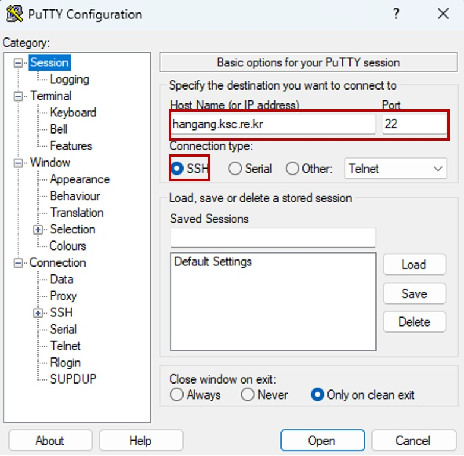
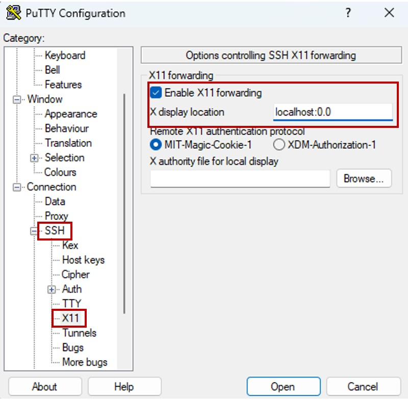
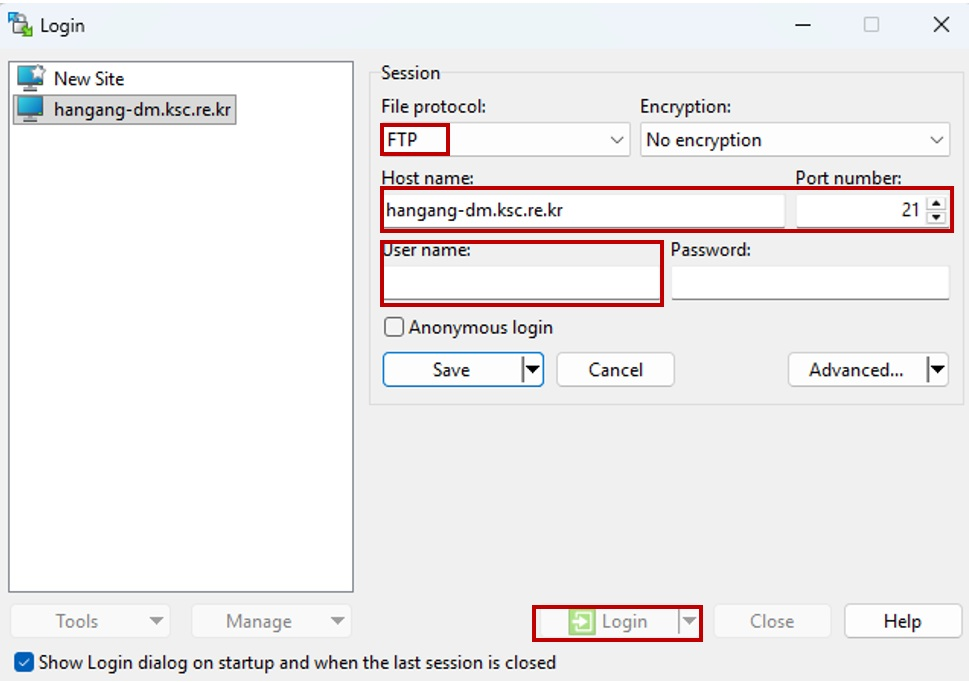

# 사용자 환경

## 가. 계정발급

한강 시스템의 사용을 승인받은 연구자는 KISTI 국가슈퍼컴퓨팅센터 홈페이지(https://www.ksc.re.kr) 웹 서비스를 통해 계정을 신청합니다.

### 1. 계정 신청

#### **1) 신청 방법 : KISTI 홈페이지 웹사이트 접속, (상단) 사용신청 -> (상단) 신청 -> 신청서선택**

* 무료계정 : 한강 시스템 혁신지원사업, 6호기 초보사용자
* 유료계정 : 6호기 일반사용자, 6호기 학생사용자
* 계정 발급 완료 시 신청서에 기입한 이메일로 계정 관련 정보 발송

#### **2) OTP (One Time Password, 일회용 비밀번호) 인증코드 발급**

* OTP 인증코드는 최초 아이디 발급시 자동으로 발급하여 안내(카카오톡 혹은 이메일)드립니다.
* 발급시 카카오톡(SMS) 혹은 이메일로 수신하신 "OTP 인증코드 발급 안내"를 참고하시기 바랍니다.
* 이후 휴대폰 교체 등의 사유로 재발급이 필요한 경우, 재발급사이트(https://otp.ksc.re.kr)를 이용해주시기 바랍니다.

#### **3) OTP 앱 설치**

* 슈퍼컴퓨팅 보안 접속을 위해 OTP 스마트폰 앱이 제공됩니다.
* OTP 스마트폰 앱은 안드로이드 앱 스토어(Google Play)나 아이폰 앱 스토어(App Store)에서 “AnyAuth”로 검색 후 한국정보인증(구:미래기술(mirae-tech))에서 개발한 앱을 설치하여 사용할 수 있습니다.

※ 슈퍼컴퓨터 로그인 시 “AnyAuth” 앱의 OTP 보안숫자(6자리)를 반드시 입력해야 합니다.

※ 스마트폰을 사용하고 있지 않은 사용자의 경우, 계정담당자(account@ksc.re.kr)에게 문의 바랍니다.

※ 자세한 OTP 설치 및 이용방법은 사용자포털(www.ksc.re.kr) > "알림·소식" > "자료실" > "시스템지침서"에서 “\[안내] OTP 사용자 포털 서비스 개시(OTP 발급/재발급/취소)”를 참고 바랍니다.

#### **4) OTP 폐기**

* OTP의 경우 180일 동안 미사용시 발급된 OTP가 폐기됩니다.
* 이 경우 OTP 재발급사이트(otp.ksc.re.kr)를 통해서 재발급이 가능합니다.

## 나. 로그인 <a href="#id-1" id="id-1"></a>

* 사용자는 한강 시스템 로그인 노드(hangang.ksc.re.kr, hangang-cpu.ksc.re.kr)를 통해 접근 가능합니다. (하단, 노드 구성 참조).
  * 웹 브라우저를 통해 MyKSC(KISTI 슈퍼컴퓨터 웹 서비스 포털, [https://portal.my-6th.ksc.re.kr](https://portal.my-6th.ksc.re.kr))에 로그인하여 GUI 기반의 HPC 및 AI/데이터분석 서비스를 활용할 수 있습니다. (사용법은 [MyKSC 지침서](https://docs-ksc.gitbook.io/myksc-hangang) 참조)
* 기본 문자셋(encoding)은 유니코드(UTF-8)입니다.
* 로그인 노드에 대한 접근은 ssh, scp, sftp, X11 만 허용됩니다.

### 1. 한강 GPU를 활용할 경우 <a href="#id-1-1" id="id-1-1"></a>



* 한강 GPU를 사용할 경우에는 hangang.ksc.re.kr로 접속을 합니다.

```
$ ssh -l <사용자ID> hangang.ksc.re.kr [-p 22]
```

* 예) 사용자ID가 x123abc일 경우

```
$ ssh -l x123abc hangang.ksc.re.kr
혹은
$ ssh -l x123abc hangang.ksc.re.kr -p 22
```

* Password(OTP)에는 OTP 6자리 숫자 토근을 Password에는 슈퍼컴퓨터 로그인 비밀번호롤 입력합니다.

```
$ ssh -l x123abc hangang.ksc.re.kr
(x123abc@hangang.ksc.re.kr) Password(OTP): OTP 6자리 숫자 토큰
(x123abc@hangang.ksc.re.kr) Password: 슈퍼컴퓨터 로그인 비밀번호
```

※ 리눅스 보안 정책상 입력하는 OTP 토큰 및 로그인 비밀번호는 화면에 표시되지 않습니다. 정확히 입력하신 후 엔터를 누르시기 바랍니다.&#x20;

※ OTP 토큰은 입력 실패시 최대 30초이후 변경된 새로운 토큰을 입력해야 합니다. (재사용 불가)&#x20;

※ 3회 실패시 누적 10분간 hangang 접근이 제한됩니다. 장시간 접근이 안되시면 상담(시스템 >> 시스템 접속)에 내용을 남겨주시기 바랍니다.



* X환경 실행을 위해 Xming 실행
  * 프로그램은 인터넷을 통해 무료로 다운로드 후 설치할 수 있습니다.


* putty나 SSH Secure Shell Client 등의 ssh 접속 프로그램을 이용합니다.
  * Host Name : hangang.ksc.re.kr, Port : 22, Connection type : SSH
  * 프로그램은 인터넷을 통해 무료로 다운로드 가능

<figure><figcaption></figcaption></figure>

* ssh -> X11 tab -> check "Enable X11 forwarding"
* X display location : localhost:0.0

<figure><figcaption></figcaption></figure>

※ 만약, DNS 캐싱 문제로 접속이 안 될 경우에는 캐시를 정리 (명령 프롬프트에서 ipconfig/flushdns 명령어 수행)하고 재접속 진행합니다.

```
C: ipconfig /flushdns
```



### 2. 한강 CPU를 활용할 경우 <a href="#id-1-1" id="id-1-1"></a>





* 한강 CPU를 사용할 경우에는 hangang-cpu.ksc.re.kr로 접속을 합니다.

```
$ ssh -l <사용자ID> hangang-cpu.ksc.re.kr [-P 22]
```

* 예) 사용자ID가 x123abc일 경우

```
$ ssh -l x123abc hangang-cpu.ksc.re.kr
혹은
$ ssh -l x123abc hangang-cpu.ksc.re.kr -P 22
```

* Password(OTP)에는 OTP 6자리 숫자 토근을 Password에는 슈퍼컴퓨터 로그인 비밀번호롤 입력합니다.

```
$ ssh -l x123abc hangang-cpu.ksc.re.kr
(x123abc@hangang-cpu.ksc.re.kr) Password(OTP): OTP 6자리 숫자 토큰
(x123abc@hangang-cpu.ksc.re.kr) Password: 슈퍼컴퓨터 로그인 비밀번호
```

※ 리눅스 보안 정책상 입력하는 OTP 토큰 및 로그인 비밀번호는 화면에 표시되지 않습니다. 정확히 입력하신 후 엔터를 누르시기 바랍니다.&#x20;

※ OTP 토큰은 입력 실패시 최대 30초이후 변경된 새로운 토큰을 입력해야 합니다. (재사용 불가)&#x20;

※ 3회 실패시 누적 10분간 nurion 접근이 제한됩니다. 장시간 접근이 안되시면 상담(시스템 >> 시스템 접속)에 내용을 남겨주시기 바랍니다.



* X환경 실행을 위해 Xming 실행
  * 프로그램은 인터넷을 통해 무료로 다운로드 후 설치할 수 있습니다.


* putty나 SSH Secure Shell Client 등의 ssh 접속 프로그램을 이용합니다.
  * Host Name : hangang-cpu.ksc.re.kr, Port : 22, Connection type : SSH
  * 프로그램은 인터넷을 통해 무료로 다운로드 가능
* ssh -> X11 tap -> check "Enable X11 forwarding"
* X display location : localhost:0.0

<figure><figcaption></figcaption></figure>

※ 만약, DNS 캐싱 문제로 접속이 안 될 경우에는 캐시를 정리 (명령 프롬프트에서 ipconfig/flushdns 명령어 수행)하고 재접속 진행합니다.

```
C: ipconfig /flushdns
```



### 3. 파일 송수신 <a href="#id-3" id="id-3"></a>

* FTP 클라이언트를 통해 ftp나 sftp로 Datamover 노드(hangang-dm.ksc.re.kr)로 접속하여 파일을 송수신 합니다. (하단, 노드구성 참조)

```
$ ftp hangang-dm.ksc.re.kr
또는
$ sftp [사용자ID@]hangang-dm.ksc.re.kr [-P 22]
```

* 윈도우 환경에서는 WinSCP와 같이 무료로 배포되고 있는 FTP/SFTP 클라이언트 프로그램을 이용하여 접속합니다.

<figure><figcaption></figcaption></figure>

* FTP (File Tranfer Protocal)을 이용하며, OTP를 입력하지 않고 파일 전송 가능
* SFTP(Secure-FTP) 을 이용하며, 파일 전송시 OTP를 입력해야 합니다.(FTP보다 안전한 전송방식)

### 4. 노드구성 <a href="#id-4" id="id-4"></a>

<table><thead><tr><th align="center"></th><th align="center"></th><th align="center">호스트명</th><th align="center">CPU Limit</th><th align="center">비고</th></tr></thead><tbody><tr><td rowspan="2" align="center">로그인 노드</td><td align="center">cpu 로그인</td><td align="center">hangang-cpu.ksc.re.kr</td><td align="center">120분</td><td align="center"><p>-   ssh/scp 접속 가능</p><p>-  컴파일 및 batch 작업제출용</p><p>-  ftp/sftp 접속 불가</p></td></tr><tr><td align="center">gpu 로그인</td><td align="center">hangang.ksc.re.kr</td><td align="center">120분</td><td align="center"><p>-  ssh/scp 접속 가능</p><p>-  컴파일 및 batch 작업제출용</p><p>-  ftp/sftp 접속 불가</p></td></tr><tr><td align="center">Datamover 노드</td><td align="center">DM 로그인</td><td align="center">hangang-dm.ksc.re.kr</td><td align="center">-</td><td align="center"><p>- ssh/scp/sftp 접속 가능</p><p>- ftp 접속 가능</p><p>- 컴파일 및 작업제출 불가</p></td></tr><tr><td rowspan="2" align="center">계산노드</td><td align="center">x86_64</td><td align="center">cnode[0001-0804]</td><td align="center">-</td><td rowspan="2" align="center"><p>- slurm 스케줄러를 통해 작업 실행 가능</p><p>- 일반사용자 직접 접근 불가</p></td></tr><tr><td align="center">aarch64</td><td align="center">node[0001-2086]</td><td align="center">-</td></tr></tbody></table>

* wget, git을 이용한 다운로드 및 대용량 데이터의 전송은 CPU Limit이 없는 Datamover 노드를 사용할 것을 권장합니다. (로그인 노드에서 수행 시에 CPU Limit에 따라 전송 중에 끊어질 수 있습니다.)
* 파일 압축, 해제 또한 CPU Limit에 따라 중단될 수 있으며, 로그인 노드에서 프로세스가 강제로 중단되는 경우에는 Datamover 노드에서 압축/해제 진행합니다.

## 다. 사용자 쉘 변경 <a href="#id-5" id="id-5"></a>

* 한강 시스템의 로그인 노드는 기본 쉘로 bash이 제공됩니다. 다른쉘로 변경하고자 할 경우 chsh 명령어를 사용합니다.

```
$ chsh
```

* 현재 사용 중인 쉘을 확인하기 위해서 echo $SHELL을 이용하여 확인합니다.

```
$ echo $SHELL
```

* 쉘의 환경설정은 사용자의 홈 디렉터리에 있는 환경설정 파일(.bashrc, .cshrc 등)을 수정하여 사용하면 됩니다.

## 라. 사용자 비밀번호 변경 <a href="#id-6" id="id-6"></a>

* 사용자 비밀번호를 변경하는 방법은 한강에 접속 한 후 passwd 명령어를 통한 변경과 사용자 포털(www.ksc.re.kr)을 통한 변경 2가지 방법이 제공됩니다.
  * 패스워드 변경 기간(60일)이 지나서 한강에 접속을 못 할 경우에는 사용자 포털을 통해서 변경해야 합니다.

### 1. password 명령어를 통한 변경 <a href="#id-1.-password" id="id-1.-password"></a>

* 사용자 패스워드를 변경하기 위해서는 한강에 슈퍼컴퓨터 아이디를 통해 로그인 한 후 passwd 명령을 사용합니다.

```
$ passwd
```

* 패스워드 관련 보안 정책
  * 사용자 패스워드 길이는 최소 9자이며, 영문, 숫자, 특수문자의 조합으로 이뤄져야 합니다. 영문 사전 단어는 사용이 불가합니다.
  * 사용자 패스워드 변경 기간은 2개월로 설정(60일) 됩니다.
  * 새로운 패스워드는 최근 5개의 패스워드와 유사한 것을 사용 할 수 없습니다.
  * 최대 로그인 실패 허용 횟수 : 5회
    * 5회 이상 틀릴 경우, 이 계정의 ID는 lock이 걸리므로, 계정담당자(account@ksc.re.kr)에게 문의해야 합니다.
      * 같은 PC에서 접속을 시도하여 5회 이상 틀릴 경우, 해당 PC의 IP 주소는 일시적으로 block 되므로 이 경우에도 계정 담당자(account@ksc.re.kr)에게 문의해야 합니다.
  * OTP 인증 오류 허용 횟수 : 5회
    * 5회 이상 틀릴 경우, 계정 담당자(account@ksc.re.kr)에게 문의해야 합니다.

### 2. 사용자 포털(www.ksc.re.kr)을 통한 변경 <a href="#id-2.-www.ksc.re.kr" id="id-2.-www.ksc.re.kr"></a>

* 패스워드 변경 기간(60일)이 지났을 경우 비밀번호 변경은 사용자 포털(www.ksc.re.kr)을 통해서 가능합니다.
  * "마이페이지" -> "계정관리" ->"계정관리" -> 슈퍼컴 비밀번호 변경
* 변경된 비밀번호 동기화까지 다소 시간이 소요됩니다.

## 마. 사용자 계정 SRU Time 사용량 확인 <a href="#sru-time" id="sru-time"></a>

* 통합 슈퍼컴퓨터 계정 관리 시스템(ISAM)에 접속하여 사용자 계약정보, 배치 작업 사용 상세내역, 총 SRU time 사용량 등을 확인할 수 있습니다.

```
$ isam
```

#### **1) 과금 시간 (Service Resource Unit time:SRU Time) 이란 ?**

* 도입 금액 및 시기, 성능이 서로 다른 시스템의 사용료를 일괄적으로 적용하기 위해서 사용되며, 각 시스템별로 산정된 이용료에 기준 요율을 곱하여 평준화(normalize) 한 시간
* 사용료 납부시 1구좌 / 100만원당 100 SRU time 부여하며, 기준 요율은 기준요율 = 100 SRU Time / Node Time (구좌당 노드 제공 시간)으로 계산

#### **2) SRU time 적용 예시(한강 기준)**

* GPU 파티션 : 1구좌당 약 300 Node Hour(100 SRU Time) 사용 가능
* CPU 파티션 : 1구좌당 약 1,000 Node Time Hour(100 SRU Time) 사용 가능
* GPU Fat 노드 : 1구좌당 약 120 Node Time Hour(100 SRU Time) 사용 가능
* 대용량 메모리 노드 : 1구좌당 약 32 Node Time Hour(100 SRU Time) 사용 가능

<table><thead><tr><th width="123.045654296875" align="center">1구좌/100만원당</th><th width="127.30029296875" align="center">노드 당 Core수(A)</th><th width="88.16650390625" align="center">노드 당 GPU수</th><th width="144.090087890625" align="center">노드 사용 시간(B)</th><th width="158.40283203125" align="center">기준 요율(C)</th><th align="center">SRU Time (D=B×C)</th></tr></thead><tbody><tr><td align="center">GPU 파티션</td><td align="center">288</td><td align="center">4</td><td align="center">약 300 노드시간</td><td align="center">3.331984 x 10 <sup>-1</sup></td><td align="center">100</td></tr><tr><td align="center">CPU 파티션</td><td align="center">256</td><td align="center">-</td><td align="center">약 1,000 노드시간</td><td align="center">9.999872 x 10 <sup>-2</sup></td><td align="center">100</td></tr><tr><td align="center">GPU Fat 노드</td><td align="center">64</td><td align="center">8</td><td align="center">약 120 노드시간</td><td align="center">8.3339968 x 10 <sup>-1</sup></td><td align="center">100</td></tr><tr><td align="center">대용량 메모리 노드</td><td align="center">1,024</td><td align="center">-</td><td align="center">약 32 노드시간</td><td align="center">3.124992 x 10 <sup>0</sup></td><td align="center">100</td></tr></tbody></table>

※ 자세한 요금 내용은 아래 국가슈퍼컴퓨팅센터 홈페이지 요금안내([https://www.ksc.re.kr/jwsc/gjbg/ygan](https://www.ksc.re.kr/jwsc/gjbg/ygan))를 참조해 주십시오.

<br>

## 바. 사용자 파일시스템 및 쿼터 정책 <a href="#id-7" id="id-7"></a>

* 사용자에게는 홈 디렉터리(/home01/$USER)와 스크래치 디렉터리(/scratch/$USER), 앱스데이터(/appsdata/$USER) 파일시스템이 제공됩니다.

<table><thead><tr><th align="center">구분</th><th align="center">디렉토리 경로</th><th align="center">쿼터 정책</th><th align="center">용량제한</th><th align="center">파일수 제한</th><th align="center">파일 삭제(퍼지) 정책</th><th align="center">파일 시스템</th><th align="center">백업 유무</th></tr></thead><tbody><tr><td align="center">홈 디렉토리</td><td align="center">/home01</td><td align="center">유저쿼터</td><td align="center">64 GB</td><td align="center">500K</td><td align="center">N/A</td><td rowspan="3" align="center">Lustre</td><td align="center">O</td></tr><tr><td align="center">스크래치 디렉토리</td><td align="center">/scratch</td><td align="center">그룹쿼터</td><td align="center">80TB</td><td align="center">5M</td><td align="center"><mark style="color:$danger;"><strong>15일 동안 접근하지 않은 파일은 자동 삭제</strong></mark></td><td align="center">X</td></tr><tr><td align="center">앱스데이터 디렉토리</td><td align="center">/appsdata</td><td align="center">그룹쿼터</td><td align="center">20TB</td><td align="center">5M</td><td align="center">N/A</td><td align="center">X</td></tr></tbody></table>

* 홈 디렉터리는 용량 및 I/O 성능이 제한되어 있어 모든 계산 작업은 스크래치 디렉터리인 /scratch의 사용자 작업 공간에서 이루어져야 합니다.
* 사용자의 현재 사용량은 아래 명령어로 확인이 가능합니다.

```
$ lfs quota -uh $uid /home01
$ lfs quota -gh $gid /scratch
$ lfs quota -gh $gid /appsdata
```

* 파일 삭제 정책은 파일 속성 중 atime을 기준으로 적용됩니다.
  * atime(Access timestamp): 마지막 접근 시간
  * mtime(Modified timestamp): 파일의 마지막 변경 시간 의미
  * ctime(Change timestamp):파일의 퍼미션, 소유자, 링크 등에 의한 inode 변경 시간 의미

※ 삭제 정책(15일동안 접근하지 않은 파일은 자동 삭제)에 따라 삭제된 파일의 복구는 기본적으로 불가능 합니다.

* atime은 stat, ls -lu 명령 등으로 확인할 수 있습니다.

```
[login01 ~]# stat file1
File: ‘file1’ Size: 0 Blocks: 0 IO Block: 4096 regular empty file
Device: 805h/2053d Inode: 3221237903 Links: 1
Access: (0644/-rw-r--r--) Uid: ( 0/ root) Gid: ( 0/ root)
Access: 2022-04-05 08:52:30.113048319 +0900
Modify: 2022-04-05 08:52:30.113048319 +0900
Change: 2022-04-05 08:52:30.113048319 +0900
```

```
$ ls -lu test.file
-rw-r--r-- 1 testuser testgroup 58 Jan 1 17:06  test.file
```

<br>
